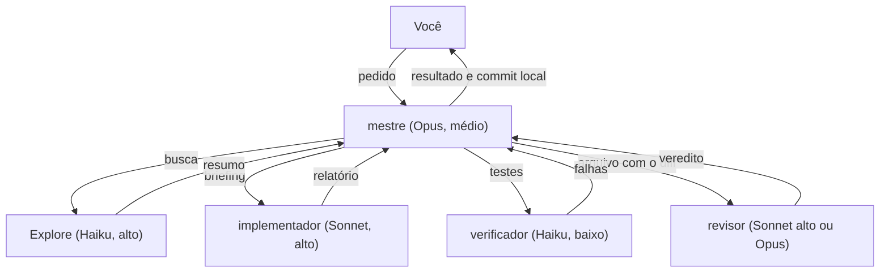

# Equipe de agentes para o Claude Code

Uma sessão principal, o **mestre**, coordena quatro subagentes. Cada um roda no modelo mais barato que dá conta do papel. As regras ficam em camadas, o briefing e o relatório são padronizados, os comandos mais perigosos ficam bloqueados nas configurações e uma guarda limita o terminal dos subagentes: o Explore e o verificador só rodam o que precisam, e o implementador não consegue formatar a pasta inteira.

O objetivo é gastar menos tokens sem abrir mão da qualidade e da segurança do código.

## A equipe

| Agente | Modelo | Esforço | Papel |
|---|---|---|---|
| mestre (a sessão que você abre) | Opus | médio | entende o pedido, planeja, delega, integra, faz o commit e fala com você |
| Explore (explorador) | Haiku | alto | localiza e resume código; no terminal, só lê o histórico do git; consulta o mapa do código, se instalado |
| implementador | Sonnet | alto | escreve o código dentro do escopo do briefing |
| verificador | Haiku | baixo | roda os comandos de teste, lint, tipos e build listados no projeto e resume as falhas |
| revisor | Sonnet (Opus em área sensível) | alto | revisa o diff com contexto limpo, só leitura, sem terminal |

Você abre **uma sessão só**. O mestre cria os subagentes quando precisa.

O explorador se chama `Explore` de propósito. O Claude Code já traz um subagente com esse nome, que roda no modelo da sessão principal, ou seja, em Opus. Um subagente seu com o mesmo nome substitui o embutido, e assim toda busca passa a rodar em Haiku, inclusive as que o mestre faz por hábito.



## O que vem no repositório

| Caminho | O que é | Vai para |
|---|---|---|
| `rules/equipe-agentes.md` | regras de trabalho: princípios, orquestração, briefing, relatório, segurança | `~/.claude/rules/` |
| `agents/*.md` | os 4 subagentes, com modelo, esforço e ferramentas de cada um | `~/.claude/agents/` |
| `hooks/guarda-comandos.ps1` | guarda de terminal do Explore, do verificador e do implementador | `~/.claude/hooks/` |
| `hooks/equipe-*.mjs` | boletim de início de sessão, contexto automático dos subagentes, travas de banco, de segredos e de leitura do Explore, aviso no celular, memória entre computadores e medidor das sessões (Node) | `~/.claude/hooks/` |
| `skills/retro-equipe/` | skill `/retro-equipe`: retrospectiva com números e propostas testadas | `~/.claude/skills/` |
| `skills/objetivo/` | skill `/objetivo`: o pedido vira um objetivo com condição de parada, e a equipe segue até o fim sem parar para perguntar | `~/.claude/skills/` |
| `CLAUDE.md`, `.claude/verificador-comandos.txt` | regras e comandos de teste para trabalhar nesta pasta (é aqui que a retrospectiva aplica as mudanças) | ficam no repositório |
| `settings/hooks.json` | registro dos hooks da equipe | mesclar em `~/.claude/settings.json` |
| `settings/global.json` | bloqueios que valem em todo projeto | mesclar em `~/.claude/settings.json` |
| `settings/retiradas.json` | regras que versões anteriores acrescentavam e o instalador agora remove | usado pelo instalador |
| `projeto/mcp.supabase-leitura.json` | conexão do Supabase só de leitura, para consultas sem pedir aprovação | `.mcp.json` do projeto |
| `projeto/CLAUDE.md` | modelo do arquivo de cada projeto | raiz do projeto |
| `projeto/nota-de-area.md` | modelo de nota por pasta | `CLAUDE.md` dentro da pasta |
| `projeto/mcp.dart.json` | registro do servidor MCP oficial do Dart | registrado pelo instalador quando o Dart 3.13+ está instalado, ou copiado como `.mcp.json` num projeto |
| `projeto/mcp.codebase-memory.json` | registro do servidor do mapa do código (codebase-memory) | registrado pelo instalador (sempre, a menos que use `-SemMapa`), ou copiado como `.mcp.json` num projeto |
| `ferramentas/registrar-mcp.mjs`, `ferramentas/ler-mcp.mjs` | scripts em Node que o instalador usa para registrar e ler servidores no `.claude.json` | usado pelo instalador |
| `projeto/verificador-comandos.txt` | modelo da lista de comandos que o verificador pode rodar | `.claude/` do projeto |
| `settings/projeto.exemplo.json` | exemplo de bloqueios mais rígidos para um projeto | `.claude/settings.json` do projeto |
| `exemplos/flutter-supabase/` | exemplo preenchido de `CLAUDE.md` e da lista do verificador | referência |
| `baixar-e-instalar.ps1` | baixa ou atualiza o repositório e roda o instalador (a linha do `irm ... \| iex`) | executar |
| `instalar.ps1` | instalador para Windows | executar |
| `testes/comportamento/` | testes de comportamento: o Claude Code de verdade em tarefas fixas, conferido na transcrição | executar quando quiser |
| `testes/` | casos da guarda, teste do instalador e conferência das ferramentas do Dart, que rodam no Windows PowerShell 5.1 e no PowerShell 7, e testes em Node dos hooks e do medidor | executar |
| `.github/workflows/testes.yml` | roda os testes no Windows a cada mudança no GitHub | automático |
| `docs/como-funciona.md` | explicação detalhada | leitura |
| `docs/modelos.md` | preços e benchmarks oficiais dos modelos 5.5 e o motivo de cada escolha | leitura |

No Windows, `~/.claude` é a pasta `%USERPROFILE%\.claude`.

## As quatro camadas

| Onde | O quê | Quem lê |
|---|---|---|
| Global (`~/.claude/rules/` e `~/.claude/agents/`) | como trabalhar | todas as sessões, em todos os projetos |
| Projeto (`CLAUDE.md` na raiz) | o que é este projeto: stack, comandos, regras próprias | sessões abertas naquele projeto |
| Configurações (`settings.json`) | o que é proibido | o próprio Claude Code, antes de executar |
| Memória do projeto | onde paramos | só a sessão principal |

Regra prática: instrução que precisa chegar aos subagentes vai nos arquivos de regras, nunca só na memória. Os subagentes não recebem a memória da sessão principal.

## Requisitos

- Claude Code em versão recente: aba Code do app para Windows ou macOS, terminal ou extensão.
- Acesso aos modelos Opus, Sonnet e Haiku.
- Para o instalador: Windows com PowerShell.

## Instalação

### Opção 1: tudo automático (Windows)

Abra o PowerShell (não precisa ser administrador) e cole:

```powershell
irm https://raw.githubusercontent.com/renangr87/claude-equipe-agentes/main/baixar-e-instalar.ps1 | iex
```

Se o app do Claude estiver aberto, o instalador pede para fechar: aperte Enter e ele fecha. Ao terminar, abra o app e comece uma conversa nova. Para atualizar depois, rode a mesma linha: ela faz `git pull` e reinstala só o que mudou.

O que acontece, em ordem:

1. Baixa ou atualiza este repositório em `%USERPROFILE%\claude-equipe-agentes` (instala o Git pelo winget se faltar).
2. Copia os 4 subagentes para `%USERPROFILE%\.claude\agents`, trocando o marcador `__PASTA_CLAUDE__` pelo caminho real da pasta, a guarda de terminal para `hooks` e a regra global para `rules`.
3. Acrescenta os bloqueios ao `%USERPROFILE%\.claude\settings.json`. Só remove regras antigas da própria equipe, listadas em `settings/retiradas.json`; o que você escreveu fica.
4. **Mapa do código:** se o programa faltar, instala pelo instalador oficial, só o binário (`--skip-config`), e registra. Veja [Mapa do código](#mapa-do-código-obrigatório-em-projeto-médio-ou-grande).
5. **Servidor do Dart:** se achar o Dart 3.13 ou mais novo, confere o servidor e registra. Sem Dart, pula. Veja [Servidor do Dart](#servidor-do-dart-opcional).
6. **Apoio Local:** baixa ou atualiza o [apoio-local-ollama](https://github.com/renangr87/apoio-local-ollama) em `%USERPROFILE%\apoio-local-ollama`, cria o ambiente Python dele, liga o Ollama (instala se faltar), baixa o modelo se o Ollama não tiver nenhum e registra. Veja [Apoio local](#apoio-local).
7. **Hooks e retrospectiva:** acrescenta ao `settings.json` o boletim de início de sessão e o contexto automático dos subagentes, copia as skills `/retro-equipe` e `/objetivo` e grava a versão instalada. Veja [Boletim, contexto automático e retrospectiva](#boletim-contexto-automático-e-retrospectiva).

O que faltar no caminho (Node.js, Python 3.12, Git, Ollama) é instalado pelo winget. Um passo que falha não trava os outros: o instalador escreve `ATENCAO` ou `nao registrado` com o motivo e segue.

Ele não apaga arquivos. Antes de alterar um arquivo que já existe, grava uma cópia ao lado com o sufixo `.bak-<data>-<hora>`.

Se você já tem o repositório na máquina, o mesmo resultado sai de:

```powershell
powershell -ExecutionPolicy Bypass -File .\instalar.ps1
```

Opções:

| Opção | O que faz |
|---|---|
| `-SemBloqueios` | não mexe no `settings.json` (nem nos bloqueios, nem nos hooks) |
| `-SemHooks` | não acrescenta os hooks da equipe; o resto do `settings.json` é atualizado |
| `-SemMapa`, `-SemDart`, `-SemApoio` | deixa de fora o mapa, o servidor do Dart ou o Apoio Local |
| `-ApoioLocal <servidor.py>` | usa uma cópia do Apoio Local que você já tem, sem baixar |
| `-PastaApoio <pasta>` | onde guardar o Apoio Local baixado |
| `-ModeloApoio <nome>` | modelo fixado no Apoio Local (padrão `gemma4:12b`) |
| `-SemInstalar` | não instala nem baixa nada: só registra o que já existe |
| `-ApoioCasa` | no PC da placa de vídeo: libera o Ollama para os seus outros computadores pelo Tailscale (veja [Apoio local](#apoio-local)) |
| `-ApoioEmpresa [-NomeCasa <nome>]` | no outro computador: usa o Ollama de casa pelo Tailscale (veja [Apoio local](#apoio-local)) |
| `-Memoria <endereço do repositório>` | sincroniza a memória automática do Claude Code entre os seus computadores por um repositório privado (veja [Aviso no celular, memória e trava de segredos](#aviso-no-celular-memória-e-trava-de-segredos)) |
| `-SemAviso` | não cria o aviso no celular (ntfy) |
| `-SemAutoIndex` | não mexe na configuração do mapa do código (por padrão o instalador liga a indexação automática; para desligá-la depois: `codebase-memory-mcp config set auto_index false`) |
| `-ModeloMestre opusplan\|opus\|sonnet` | grava o modelo da sessão principal no `settings.json`; sem a opção, o modelo não é tocado (veja [docs/modelos.md](docs/modelos.md)) |

Para passar opções pela linha de uma vez, use esta forma (troque `-ApoioCasa` pelo que quiser):

```powershell
& ([scriptblock]::Create((irm https://raw.githubusercontent.com/renangr87/claude-equipe-agentes/main/baixar-e-instalar.ps1))) -ApoioCasa
```

### Opção 2: manual (qualquer sistema)

1. Copie `agents/*.md` para `~/.claude/agents/`. Em `Explore.md`, `verificador.md` e `implementador.md`, troque `__PASTA_CLAUDE__` pelo caminho absoluto da pasta, com barras `/` (no Windows, algo como `C:/Users/voce/.claude`).
2. Copie `hooks/guarda-comandos.ps1` para `~/.claude/hooks/`.
3. Copie `rules/equipe-agentes.md` para `~/.claude/rules/`.
4. Abra `~/.claude/settings.json` (crie se não existir) e acrescente as entradas de `settings/global.json` às listas `permissions.deny` e `permissions.ask`. Se o arquivo não existir, basta copiar `settings/global.json` com o nome `settings.json`.

No macOS e no Linux:

```bash
mkdir -p ~/.claude/agents ~/.claude/rules ~/.claude/hooks
for f in agents/*.md; do
  sed -e "s#__PASTA_CLAUDE__#$HOME/.claude#g" -e 's#"powershell.exe"#"pwsh"#' "$f" > ~/.claude/agents/$(basename "$f")
done
cp hooks/guarda-comandos.ps1 ~/.claude/hooks/
cp rules/equipe-agentes.md ~/.claude/rules/
```

Fora do Windows, a guarda precisa do PowerShell 7 (`pwsh`) instalado. Sem ele, o hook não roda e o terminal desses três agentes fica sem a trava.

### Conferir a instalação

No fim, o instalador roda o diagnóstico da equipe: confere se cada hook está no `settings.json` e o script existe, se o Node responde, se os agentes têm a guarda, quais servidores estão registrados (mapa, Apoio, Dart), se a indexação automática do mapa está ligada, se o aviso e a memória estão configurados (e se o último envio da memória saiu) e se a versão instalada é a do GitHub. Cada problema vem com o que fazer. Para rodar de novo à mão: `node "$HOME\.claude\hooks\equipe-diagnostico.mjs"`. O boletim de início faz uma versão rápida (só arquivos) e mostra uma linha quando algo está errado.

Depois, abra uma sessão nova e faça estes testes:

1. Pergunte: **"Quais subagentes você tem disponíveis?"** Devem aparecer implementador, verificador e revisor. O Explore aparece de qualquer forma, porque já existe no Claude Code; o seu o substitui.
2. Pergunte: **"Qual é a regra de commit da equipe?"** A resposta deve citar commit local pelo mestre, com os caminhos dos arquivos, e push só com o seu pedido.
3. Em um repositório git qualquer, peça: **"Rode `git clean -n`."** O comando deve ser recusado pelo bloqueio. O `-n` só simula, então o teste é seguro mesmo que o bloqueio não esteja ativo.
4. No mesmo repositório, peça: **"Use o Explore para rodar `git log -3 --oneline` e depois `git log -1 | sort`."** O primeiro deve funcionar e o segundo deve voltar com a mensagem "Bloqueado pela guarda (explore)". Se o segundo passar, a guarda não está rodando: confira o caminho em `~/.claude/agents/Explore.md`. Um caminho errado desliga a guarda sem aviso.
5. Peça: **"Use o verificador para rodar `git status`."** Deve voltar bloqueado pela guarda (verificador), porque `git status` não está na lista do projeto.
6. Peça: **"Use o implementador para rodar `dart format pasta-que-nao-existe/`."** Deve voltar bloqueado pela guarda (implementador), porque o formatador recebeu uma pasta. O teste é seguro mesmo sem a guarda: a pasta não existe. Peça também **"Use o implementador para rodar `supabase db push --dry-run`."**: deve voltar bloqueado pela guarda, porque o comando aponta para o banco remoto. O `--dry-run` só simula, então o teste é seguro mesmo que a guarda não esteja ativa.
7. Num projeto com git, pergunte: **"O boletim da equipe apareceu no início desta sessão? Repita a primeira linha dele."** A resposta deve trazer "Boletim da equipe (hook de início de sessão...". Se não aparecer, os hooks não estão no `settings.json` ou o Node.js não foi achado: rode o instalador de novo e veja a linha "Hooks:".
8. No mesmo projeto, peça: **"Use o Explore para repetir, palavra por palavra, a primeira linha do contexto automático que ele recebeu."** Deve voltar "Contexto automático do projeto (hook da equipe...". É o teste de que o contexto chega ao próprio subagente.
9. Num projeto com o conector do Supabase, peça: **"Rode `select 1` pelo `execute_sql` da conexão normal do Supabase, não pela de leitura."** Deve voltar "Barrado pela equipe: consulta só de leitura não vai pela conexão que escreve...", sem pedido de aprovação. Se aparecer o pedido, recuse: o hook de SQL não está no `settings.json` (veja a linha "Hooks:" do instalador).
10. Com o app ntfy assinando o tópico que o instalador mostrou, deixe uma sessão pedir aprovação (por exemplo, peça "rode `git stash pop`") e não responda: o aviso deve chegar no celular em segundos.

## Uso

1. Abra uma sessão na pasta do projeto, com **Opus**, esforço **médio** e o modo de permissão **Auto** (no seletor de modo do app). No modo Manual o Claude Code pergunta antes de quase todo comando e edição, e a sessão trava se você sair. No Auto, um segundo modelo revisa cada ação no seu lugar e só pede a você o que está na lista de confirmação da equipe. O app lembra o modo por pasta.
2. Peça o trabalho normalmente. Não precisa citar os agentes: o mestre decide quando delegar.
3. Na primeira vez em um projeto sem `CLAUDE.md`, o mestre manda o Explore levantar a stack e os comandos, mostra a proposta e grava o arquivo depois do seu OK.
4. Vai sair e quer o trabalho pronto na volta? Peça com `/objetivo` na frente (ou diga "deixe rodando até terminar"). O mestre pergunta logo o que só você pode decidir, grava o critério de pronto em `.revisao/objetivo.md` e segue até ele estar verde, sem parar para perguntar. Para só para aprovar push, gasto ou ação sem volta, e junta esses pedidos no fim. O que ele decidiu sozinho fica anotado em "Decisões", no mesmo arquivo. Quando você responde, ele volta ao trabalho até o fim. Veja a trava Objetivo em [Travas da equipe](#travas-da-equipe-hooks).
5. Ao concluir uma mudança de código, ou ao parar no meio dela, o mestre deixa `.revisao/progresso.md` em dia: o que foi feito, como foi verificado, o que falta e por onde retomar. A sessão seguinte começa por ele.

Quando mudar o ajuste da sessão:

- **Esforço alto**: só em planejamento difícil, como decisão de arquitetura ou bug que resistiu a duas tentativas. Depois volte para médio.
- **Sonnet no lugar do Opus**: se o limite de uso estiver apertando. Nos testes oficiais o Sonnet 5.5 quase empata com o Opus 5.5 pela metade do preço; a perda fica no julgamento de casos difíceis. O resto da equipe funciona igual.
- **Fable**: não compensa nesta equipe. Custa 2,5 vezes o Opus 5.5 e fica abaixo dele nos testes oficiais. Os números estão em [`docs/modelos.md`](docs/modelos.md).

## Configurar um projeto

1. Copie `projeto/CLAUDE.md` para a raiz do projeto e preencha. Deixe só o que é daquele projeto: stack, comandos, pastas, qual é o banco de produção, o que não entra em commit. Veja o exemplo em `exemplos/flutter-supabase/CLAUDE.md`.
2. Copie `projeto/verificador-comandos.txt` para `.claude/verificador-comandos.txt` no projeto e liste os comandos de teste, lint, tipos e build, um por linha. Sem essa lista, a guarda bloqueia todo comando do verificador. Faça o commit da lista: a guarda recusa a lista enquanto ela tiver mudança fora de commit, então nenhum agente libera comandos para si mesmo sem que a mudança apareça no git. Quando o mestre cria ou muda a lista pelas ferramentas de arquivo, o Claude Code também pede a sua aprovação, porque `.claude/` é pasta protegida; isso não vale para um script que grave o arquivo por conta própria.
3. Nada a fazer para o diff do revisor, o plano, o progresso e o objetivo: o mestre grava tudo na pasta `.revisao/`, que tem um `.gitignore` interno contendo `*` (se faltar, a equipe cria quando um arquivo é gravado ali), e ela nunca entra em commit.
4. Se o projeto precisa de bloqueios mais rígidos, crie `.claude/settings.json` na raiz dele a partir de `settings/projeto.exemplo.json`. As listas do projeto se somam às globais.
5. Para as partes do código que exigem conhecimento acumulado, crie uma **nota de área**: copie `projeto/nota-de-area.md` como `CLAUDE.md` dentro da pasta. Ela é carregada quando o mestre ou o implementador abrem arquivos daquela pasta. O Explore, o verificador e o revisor não carregam arquivos `CLAUDE.md`, então o mestre aponta a nota no briefing quando ela importa. É o que substitui o "desenvolvedor que já conhece o assunto".

## Bloqueios: o que fazem e o que não fazem

| Tipo | Comandos | Efeito |
|---|---|---|
| Proibido (`deny`) | `git reset --hard`, `git push --force` e `-f`, `git clean`, `git add -A`, `git add --all`, `git add .`, `git commit -a` | o Claude Code recusa |
| Proibido (`deny`) | leitura, edição e criação de `.env` e `.env.*` em qualquer pasta do computador, inclusive `.env.example` | o Claude Code recusa |
| Pede confirmação (`ask`) | descarte de trabalho: `git restore`, `git checkout -- arquivo`, `git checkout .`, `git checkout -f`, `git stash drop`, `clear` e `pop`, `git reset --merge` e `--keep`, `git switch -f` | aparece um pedido de aprovação para você |
| Pede confirmação (`ask`) | ferramentas do servidor do Dart que chamam métodos arbitrários no app rodando (`vm_service`) ou mudam as pastas que o servidor alcança (`roots`). Hot reload e restart ficam livres; as que mudam arquivos ficam desligadas no próprio servidor | aparece um pedido de aprovação para você |
| Pede confirmação (`ask`) | editar ou criar `analysis_options.yaml`, em qualquer pasta | aparece um pedido de aprovação para você. Evita que o agente afrouxe o analisador para o aviso sumir em vez de corrigir o código. Um comando de terminal que mude o arquivo não passa por essa regra |
| Pede confirmação (`ask`) | ferramentas de escrita de conectores, como as do Supabase: `execute_sql` da conexão que escreve, `apply_migration`, `deploy_edge_function`, segredos, operações de branch e de projeto, envio de arquivo (`upload_file`) | aparece um pedido de aprovação para você |
| Pede confirmação (hook) | comandos de terminal que alteram o banco remoto ou apagam dados: `supabase db push`, `functions deploy`, `secrets set`, `storage rm`, `db reset` e `migration up` com `--linked` ou `--db-url`, `psql`, `dropdb`, `pg_restore`, `prisma migrate reset` e `deploy`, `prisma db push`, `drizzle-kit push` e `migrate`, scripts como `npm run db:push`, também com `npx`, versão no nome (`supabase@latest`) e dentro de `bash -c "..."` | o hook `equipe-banco.mjs` pede a sua aprovação no mestre, até no modo Auto, e barra no implementador. Texto que só cita o comando (`git commit -m`, `echo`, `grep`), `--help` e o banco local (`supabase db reset`, `supabase start`) passam |
| Barrado na hora (hook) | chave secreta escrita em arquivo do projeto ou num commit: `service_role` e `sb_secret_` do Supabase, chaves da Anthropic, OpenAI, GitHub, AWS, Stripe, Slack, Telegram, chave privada e URL do Postgres com senha | o hook `equipe-segredos.mjs` recusa e explica onde a chave deve ficar (`.env`, variável de ambiente). A chave nunca aparece na mensagem. Chave pública (anon, publishable, a do Firebase no app), banco local e arquivo ignorado pelo git passam |
| Barrado na hora (hook) | consulta só de leitura (`select`, `with ... select`, `explain`, `show`) mandada ao `execute_sql` de uma conexão do Supabase que escreve, num projeto que tem a `supabase-leitura` | o hook `equipe-sql.mjs` recusa sem pedir nada e manda o agente usar a `supabase-leitura` (veja [Consultas ao banco sem pedir aprovação](#consultas-ao-banco-sem-pedir-aprovação)). Sem ela no projeto, ou com o seu OK no pedido ("pode rodar a consulta"), a consulta segue para a aprovação normal |
| Liberado (`allow`) | o Apoio Local (`apoio-local`), modelo do seu computador que só lê as pastas permitidas | roda sem pedir nada |
| Liberado (`allow`) | a conexão do Supabase só de leitura, `supabase-leitura` (veja [Consultas ao banco sem pedir aprovação](#consultas-ao-banco-sem-pedir-aprovação)) | roda sem pedir nada; o próprio Supabase só deixa ler |

**Por que a lista é curta.** Toda regra de confirmação pede aprovação até no modo Auto, e cada pedido trava a sessão até você responder. Por isso a lista fica só com o que é raro e sem volta. `git push` (o push forçado continua proibido), `rm -r` e hot reload saíram: no modo Auto, quem avalia essas ações é o classificador do Claude Code, que barra o que foge do pedido. O push ganhou uma trava própria (o hook `equipe-push.mjs`), que só pede confirmação quando o seu pedido não falou em push (veja [Travas da equipe](#travas-da-equipe-hooks)); no implementador, a guarda barra commit, push, dependência nova e `rm -r`. Instalações anteriores deixaram essas regras no seu `settings.json`; o instalador remove as que estão em `settings/retiradas.json`, só se estiverem escritas exatamente como a equipe escreveu.

Cada regra de comando existe duas vezes, uma para Bash e outra para PowerShell, porque no Windows o agente pode usar qualquer um dos dois.

Limites que você precisa conhecer:

- **O bloqueio compara o texto do comando.** Ele pega a forma usual, não todas. `git push --force` é barrado, `git -C . push --force` não é. A documentação do Claude Code diz que essas regras não são uma fronteira de segurança.
- **O bloqueio de `.env` vale para as ferramentas de arquivo e para comandos que o Claude Code reconhece, como `cat`, `head`, `tail` e `sed`.** Uma regra `Read` também barra editar e criar o arquivo, então não há regras `Edit` separadas. Ficam de fora `grep -r` numa pasta, scripts Python ou Node que abrem o arquivo por conta própria e, segundo o que a documentação lista, provavelmente o `Get-Content` do PowerShell.
- **O `.env.example` também fica bloqueado.** A exceção com `!` só vale para regras relativas à pasta da sessão, e a regra `//**/.env.*` precisa ser absoluta para alcançar worktrees e projetos vizinhos. Se você precisa que o agente leia o `.env.example`, troque `Read(//**/.env.*)` pelos nomes que você usa, por exemplo `Read(//**/.env.web.json)`.
- **Instalações anteriores deixaram `Read(.env)`, `Read(.env.*)` e `Read(!.env.example)` no `settings.json`.** O instalador só acrescenta regras e não remove essas. Elas não atrapalham, porque as novas cobrem mais, mas você pode apagá-las.
- **Escrita em banco de produção não se bloqueia só por lista de comandos.** As regras e a guarda pegam os comandos conhecidos (tabela acima), mas um script próprio que grava no banco passa, e nenhum padrão de texto distingue produção de teste. A proteção de verdade é o agente não ter a credencial de escrita: use chave só de leitura no ambiente dele, ou teste em banco local ou em um branch.
- **Quando uma regra precisa valer sem falha**, o passo seguinte é um [hook PreToolUse](https://code.claude.com/docs/en/hooks), que inspeciona o comando inteiro antes de rodar. A guarda dos subagentes é um hook desse tipo (veja abaixo). O [sandbox](https://code.claude.com/docs/en/sandboxing) não roda no Windows nativo.

## A guarda de terminal

`hooks/guarda-comandos.ps1` roda antes de cada comando de terminal do Explore, do verificador e do implementador, no Bash e no PowerShell. Ela é declarada no próprio arquivo de cada agente, então só vale para eles: o mestre e o revisor não passam por ela. O agente chama o script por dentro de um `try/catch` que bloqueia se o script não rodar (arquivo ausente, política de execução da empresa, erro de sintaxe).

| Agente | O que passa |
|---|---|
| Explore | `git log`, `git blame`, `git show`, `git diff`, `git status` e `git ls-files`, sem `--output`, `--ext-diff`, `--no-index` nem `--contents` |
| verificador | as linhas de `.claude/verificador-comandos.txt` do projeto, exatas ou com argumentos a mais, desde que a lista esteja em commit. Num worktree, vale a lista do próprio worktree, se ela estiver no git |
| implementador | tudo, menos formatador sem arquivos nomeados um a um, git que descarta trabalho e comando que altera o banco |

**Implementador.** Formatadores conhecidos (`dart format`, `flutter format`, `dart fix --apply`, `prettier --write`, `eslint --fix`, `black`, `ruff format`, `gofmt -w`, `go fmt`, `cargo fmt`, `dotnet format` e outros) só passam quando cada argumento é um arquivo. Pasta, `.`, curinga, variável, `$(...)` ou nenhum argumento são bloqueados em qualquer parte do comando: em comandos compostos (`cd app && dart format .`), em `xargs`, `find -exec`, `cmd /c`, `bash -c "..."`, `ForEach-Object`, `Start-Process` e `Invoke-Expression`. Redirecionamento (`2>&1`, `> saida.txt`) e nome de arquivo entre aspas com espaço funcionam. O modo só de conferir (`--check`, `--output=none`, `--dry-run`) passa, a não ser que venha junto com a opção de gravar. O texto de `git log --grep`, `grep` e `echo` não é examinado. Scripts como `npm run format` e `make format` são bloqueados, porque escondem o comando real. A lista fica em `$formatadores` no script. Também são bloqueados o git que descarta ou troca trabalho não commitado (`checkout`, `restore`, `reset`, `stash`, `clean`, `switch`, em qualquer parte do comando) e `git show`/`git cat-file` com a saída gravada em arquivo (`>`, `tee`, `Out-File`, `Set-Content`, `dd of=`, `--output`), em qualquer pasta, que refaz um arquivo a partir de uma versão antiga; só o nulo passa (`/dev/null`, e `$null` e `NUL` no PowerShell; no Git Bash, `> NUL` cria um arquivo de verdade). Também são barrados `git read-tree`, `git archive`, `git apply -R` e `git worktree remove --force`, que apaga a pasta com o trabalho não commitado de quem está nela. A lista fica em `$gitDescarte`. Linha continuada (`\` no fim, no Bash; crase, no PowerShell) conta como um comando só, e `;`, `&` e `|` entre aspas não separam partes (`git -c "a=x;y" checkout -- arquivo` é um checkout). As mensagens de bloqueio dizem o caminho certo: para ver a versão anterior, `git show HEAD:<arquivo>` sem gravar; para saber se uma falha já existia antes da mudança, `git worktree add <pasta temporária> HEAD` em vez de `git stash`; para desfazer uma mudança, editar o arquivo de volta olhando `git diff HEAD -- <arquivo>`; para o formatador, o exemplo com os arquivos nomeados (`dart format lib/a.dart lib/b.dart`). `cargo fmt` é sempre barrado (ele não recebe arquivos; o exemplo usa `rustfmt`), e `dotnet format` só passa com `--include`. Por fim, são barrados os comandos que alteram o banco remoto ou apagam dados (`supabase db push`, `supabase db reset --linked`, `supabase functions deploy`, `supabase secrets set`, `psql`, `dropdb`, `pg_restore`, `prisma migrate reset`, `prisma db push`, `drizzle-kit push` e parecidos), também dentro de `npx`, `pnpm dlx`, comandos compostos e `bash -c "..."`: o implementador escreve a migração e quem aplica é o mestre, com a sua aprovação. `supabase db reset` local, `supabase start`, `supabase migration new` e `prisma migrate dev` passam. As listas ficam em `$bancoSempre` e `$bancoRemoto`. Essa parte da guarda é a segunda linha: a primeira é o hook `equipe-banco.mjs`, que entende mais formas (opção no meio do comando, scripts do `package.json`) e também vale para o mestre. Por último, as ações sem volta, que são do mestre com o seu OK: git que grava histórico ou mexe no remoto (`commit`, `push`, `merge`, `rebase`, `tag` que não só lista, `cherry-pick`, `am`, `pull`, `revert` e `branch -d`/`-D`), instalar dependência nova (`npm install pacote`, `pnpm add`, `yarn add`, `bun add`, `pip install pacote`, `uv add`, `poetry add`, `flutter pub add`, `dart pub add`, `cargo add`, `go get`, `dotnet add package`, `composer require`, `gem install`, também por `python -m pip` e `sudo`) e apagar pasta inteira (`rm -r` e `-rf`, `Remove-Item -Recurse`, `rd /s`, `del /s`). Continuam passando `npm install` e `npm ci` sem pacote, `pip install -r requirements.txt`, `pip install -e .`, `flutter pub get`, `git rm`, `git status`, `git log` e apagar um arquivo só. Comando dentro de `$(...)` ou de crases conta, mesmo dentro de `echo`; texto entre aspas só é examinado como comando quando quem o recebe o executa (`bash -c "..."`, `cmd /c`, `iex`), então o filtro de um teste (`--testNamePattern "rd -r"`) passa. `git tag` que só lista (`--sort`, `--contains`, `-n`) e instalar o próprio projeto (`pip install .`, `go install ./cmd/x`) passam. Ficam de fora apelidos do git (`git ci`), `gh`, gerenciadores do sistema (`brew`, `winget`, `apt`) e formas sem a opção de recursão (`find -delete`). As listas ficam em `$gitGrava`, `$instaladores` e `$programasApagar`.

O implementador também tira uma foto do `git status` no começo e no fim da tarefa e relata os arquivos que mudaram. O mestre compara essa lista com o escopo antes do commit. Isso cobre o que a guarda não pega, como um script próprio em Python que reformata arquivos.

**Explore e verificador.** Para os dois, a guarda recusa:
- mais de um comando por vez;
- pipe, redirecionamento, `;`, `&&`, `$`, crase e parênteses fora do texto da lista;
- qualquer comando que cite `.env`, mesmo escondido com aspas ou caractere de escape (`.e""nv`, ``.e`nv``). Um build que lê `.env.web.json`, por exemplo, fica com o mestre.

No Explore, vale um comando `git` por vez, sem nenhum desses operadores: `git log | head` e `cd pasta && git log` também são barrados, e `git grep` não está na lista (para procurar texto, o Explore usa a ferramenta Grep). No verificador, o comando tem de ser a linha da lista, caractere por caractere: `cd app && flutter test` passa se a lista tiver essa linha, e `cd app; flutter test` é barrado. Por isso o mestre copia a linha exata da lista no briefing e o verificador, ao ser barrado, roda a linha mais parecida da lista em vez de improvisar. Com a lista em vigor numa pasta, a linha também passa depois de `cd "<essa pasta>" && ` (`; ` no PowerShell), com o caminho absoluto: é o formato que a mensagem da guarda e o contexto do verificador indicam quando a pasta da chamada sumiu ou fica fora de um repositório. Numa pasta que é um repositório sem a lista, a guarda não manda rodar de outro projeto: devolve o bloqueio, e o mestre decide no briefing. Sessão aberta fora do repositório (numa pasta temporária, com o projeto em outra) e sem lista própria: vale a lista do repositório em que o comando entra com `cd "<pasta absoluta>" && ...` (ou `;` no PowerShell), se ela estiver em commit lá e se a própria sessão editou esse repositório (repositório qualquer do disco não vale); o resto do comando é conferido contra essa lista como sempre. As leituras do Explore também têm trava, pelo hook `equipe-leitura.mjs` (rodado pelo despachante `equipe-pre.mjs`, veja [Travas da equipe](#travas-da-equipe-hooks)): a leitura que traria mais de 300 linhas é barrada (ele acha o trecho com Grep ou pelo mapa e lê com `offset` e `limit`), e depois de 12 leituras numa chamada a seguinte é barrada e ele responde com o que tem. A conta zera quando a chamada termina, então um Explore retomado começa de novo. Os dois números mudam por variáveis (veja [Personalizar](#personalizar)). Se essa trava falhar, a leitura segue: ela economiza, não protege.

Limites:
- **Um comando liberado pode fazer o que ele mesmo faz.** Se um teste escreve no banco, a guarda deixa passar. Liste só comandos que não alteram nada fora da pasta de build.
- **O hook depende do `powershell.exe`.** Se ele não for encontrado ou se a guarda passar de 30 segundos, o Claude Code deixa o comando seguir. Os outros casos de falha (script ausente, caminho errado, política de execução) bloqueiam. Os testes 4, 5 e 6 da instalação confirmam que a guarda está ativa.
- **A guarda do implementador pega formatadores conhecidos, não toda forma de reformatar.** Um script próprio que reescreve arquivos passa. Quem cobre isso é a comparação de `git status` antes do commit.
- **O Explore ainda vê um arquivo inteiro pelo histórico do git** (`git show HEAD:arquivo`). Isso fica liberado porque serve às perguntas de histórico; a trava de leitura vale para a ferramenta Read.
- **A lista do verificador depende do git.** Se a pasta `.claude/` estiver no `.gitignore` do projeto, a checagem de commit não enxerga mudanças.
- **Testes.** `testes/casos-guarda.txt` tem 456 casos e `testes/testar-guarda.ps1` roda todos do mesmo jeito que o hook, mais 77 cenários (78 no Windows: entrada vazia, JSON inválido, script ausente, lista fora de commit, lista ausente, worktree, pasta que sumiu, `cd` para a pasta da lista e outros). `testes/testar-instalador.ps1` faz 202 verificações em pastas temporárias, sem instalar nem baixar nada, com um `dart` falso para o servidor do Dart e um `python` falso (com `.venv` e `pip` simulados) para o Apoio Local. Os 177 testes em Node (`testes/*.test.mjs`) cobrem os hooks, as travas e o medidor, com repositórios git e sessões falsas montados no formato real (inclusive um segredo plantado num pedido, para garantir que ele não aparece na medição). Dois deles rodam a guarda de verdade e conferem que ela e o hook concordam sobre a lista do verificador (projeto numa subpasta e `.claude/` no `.gitignore`). `testes/conferir-dart.ps1` confere os nomes das ferramentas do servidor do Dart. A cada mudança no GitHub, todos rodam no Windows com o PowerShell 5.1 e com o PowerShell 7, e o do Dart roda também com o servidor de verdade, nas versões 3.11.3, 3.12.0, 3.13.0 e na estável. Para rodar na sua máquina: `powershell -ExecutionPolicy Bypass -File .\testes\testar-guarda.ps1`. O app do Windows em si não é testado: os testes 4, 5 e 6 da instalação cobrem essa parte.

## Ferramentas de conectores

O implementador não usa ferramentas de conectores (MCP): o arquivo dele tem `disallowedTools: Agent, mcp__*`. Assim ele não alcança, por exemplo, o banco de produção pelo conector do Supabase. Nos outros agentes e no mestre, as ferramentas de escrita mais comuns pedem confirmação (veja os bloqueios). Se você quiser que o implementador use um conector, troque `mcp__*` pelo nome do servidor que ele não deve usar, por exemplo `mcp__claude_ai_Supabase`.

### Consultas ao banco sem pedir aprovação

A ferramenta `execute_sql` do Supabase é a mesma para ler e para escrever, então na conexão normal ela pede aprovação até para um `select`. Para as consultas do dia a dia, registre no projeto uma segunda conexão, só de leitura:

1. Copie `projeto/mcp.supabase-leitura.json` para a raiz do projeto com o nome `.mcp.json` (ou junte a entrada ao `.mcp.json` que já existir) e troque `TROQUE_PELO_ID_DO_PROJETO` pelo ID do projeto no Supabase (o código que aparece na URL do painel).
2. Abra uma sessão, aceite o servidor do projeto quando o Claude Code perguntar, e autentique o `supabase-leitura` no gerenciador de servidores MCP (`/mcp`). Não precisa de token.

Nessa conexão (`read_only=true`), o Supabase roda toda consulta com um usuário do Postgres que só lê: um `insert` ou `drop` falha no próprio banco. Por isso ela fica liberada (`allow`) na lista da equipe, e a regra manda o mestre usá-la para consultas. A conexão normal continua pedindo aprovação para escrever. O nome `supabase-leitura` importa: é ele que está liberado. As regras de confirmação de `execute_sql` citam os nomes comuns da conexão que escreve (`supabase`, `Supabase`, `claude_ai_Supabase`); se a sua tiver outro nome, acrescente `mcp__<nome>__execute_sql` às regras de confirmação do seu `settings.json`.

**Trava de leitura.** Sem a trava, o agente às vezes manda um `select` pela conexão que escreve, e cada um vira um pedido de aprovação: numa semana de uso foram centenas, com as sessões paradas esperando. O hook `equipe-sql.mjs` barra na hora, sem perguntar nada, toda consulta que só lê (`select`, `with ... select`, `explain`, `show`) mandada ao `execute_sql` de uma conexão do Supabase que não seja a `supabase-leitura`, e manda o agente refazer pela conexão certa. Ele só barra quando o projeto tem a `supabase-leitura`: sem ela, a consulta segue para a aprovação normal, para a leitura nunca ficar sem caminho. E o seu OK no pedido ("pode rodar a consulta", "rode o select", ou só "sim" respondendo à pergunta) também manda a consulta para a aprovação normal, por exemplo quando a conexão de leitura está configurada mas não autenticada. Outros bancos (`postgres`, `sqlite`) não passam por ele. Uma consulta que chama função com schema na frente (`public.criar_pedido()`, `cron.schedule()`) conta como escrita, e o agente pode marcar uma escrita feita por função começando o SQL com `/* escrita */`: nos dois casos, ela vai para o pedido de aprovação. Se ela estiver configurada mas não autenticada, o agente pede a você uma vez para autenticá-la (`/mcp`) ou para autorizar a consulta pela conexão normal. O boletim de início também avisa quando um projeto com a pasta `supabase/` não tem essa conexão. O hook só barra, nunca libera: escrita (`insert`, `update`, migração) continua pela conexão normal, com aprovação, e uma consulta que ele não reconhece como leitura também.

## Mapa do código (obrigatório em projeto médio ou grande)

**Quando é obrigatório:** em projeto com mais de 50 arquivos de código, em qualquer linguagem (scripts e infraestrutura contam), ou com mais de um módulo, como app e backend. Na primeira tarefa da sessão nesse projeto, o mestre pede ao Explore para conferir o mapa e indexar se faltar. Se o mapa não estiver instalado, o mestre avisa você uma vez e segue trabalhando sem ele: a falta do mapa não trava a tarefa. Projeto pequeno e pasta sem código não precisam.

O [codebase-memory-mcp](https://github.com/DeusData/codebase-memory-mcp) (DeusData, licença MIT) lê o projeto e monta um mapa de funções, classes e de quem chama quem. Com ele, o Explore responde "onde está" e "quem chama" consultando o mapa em vez de abrir arquivo por arquivo, e o revisor vê o que depende do que mudou. O projeto publica cerca de 10 vezes menos tokens nesse tipo de pergunta, medido em 31 repositórios. Tudo fica no seu computador: o mapa é um banco local e o projeto diz que não envia código nem estatísticas. Dart é suportado com qualidade "boa" (75 a 89%), então chamadas indiretas podem escapar; em ponto crítico, o Explore confirma lendo o trecho.

O instalador da equipe faz os passos 1 e 2 sozinho e liga a indexação automática (`auto_index true`, `auto_index_limit` 50000, `auto_watch` ligado; um limite maior que o seu fica), para cada pasta, cópia e worktree ser indexada no início da sessão sem depender do Explore lembrar (desligue com `-SemAutoIndex`). O boletim de início diz se a cópia aberta está indexada; no início a frio o programa pode passar de 2 segundos, e aí o boletim fica calado. se o programa faltar, baixa o instalador oficial e roda com `--skip-config`. Os passos abaixo servem para fazer à mão ou para entender o que ele faz. O programa já instalado não é atualizado pelo instalador da equipe; para isso, feche o app do Claude e editores com IA e rode `codebase-memory-mcp update`.

**1. Instale o programa, só o binário.** O instalador oficial dele também acrescenta skill, agentes e hooks próprios ao Claude Code; esses concorreriam com a equipe e poriam texto extra em todo subagente. Por isso use `--skip-config`:

```powershell
Invoke-WebRequest -Uri https://raw.githubusercontent.com/DeusData/codebase-memory-mcp/main/install.ps1 -OutFile install.ps1
notepad install.ps1        # leia antes de rodar
powershell -ExecutionPolicy Bypass -File .\install.ps1 --skip-config
```

O script confere o checksum do binário antes de instalar. O executável não é assinado: o Windows pode mostrar o aviso do SmartScreen, e o Defender pode acusar `Trojan:Script/Wacatac.B!ml`, que o projeto descreve como falso positivo.

**2. Registre na equipe.** Rode o nosso instalador. O mapa é registrado sempre; só fica de fora com `-SemMapa`. Se o programa não for encontrado nem puder ser instalado, o instalador avisa e segue com o resto. Ele acha o `codebase-memory-mcp` no PATH (ou na pasta padrão do instalador oficial) e registra o caminho completo no `%USERPROFILE%\.claude.json`, com backup antes e sem mexer num registro que já exista. Precisa do Node.js, que faz a junção do arquivo (o `.claude.json` costuma ser grande demais para o Windows PowerShell 5.1). Para usar só num projeto, copie `projeto/mcp.codebase-memory.json` para a raiz dele como `.mcp.json`.

**3. Teste.** Num projeto, peça: **"Use o Explore para dizer quem chama <uma função>."** Na primeira vez ele indexa o projeto.

Como o mapa se mantém atualizado: enquanto houver uma sessão aberta no projeto, o programa observa o git em segundo plano e reindexa só o que mudou. Ao abrir uma sessão nova, ele compara pelo git o que mudou nesse meio-tempo. Pasta sem git não é observada. O Explore e o revisor conferem `index_status` antes de confiar no mapa.

O que fica de fora de propósito:
- **Skill, agentes e hooks do projeto:** não instalados (`--skip-config`).
- **Ferramentas de escrita:** o Explore e o revisor só recebem as de consulta. `delete_project`, `manage_adr` e `ingest_traces` pedem confirmação em `global.json`.
- **Mapa salvo no git:** o projeto oferece gravar `.codebase-memory/graph.db.zst` no repositório, mas o arquivo é regravado a cada atualização e incha o histórico. Deixe desligado (é o padrão) e ponha `.codebase-memory/` no `.gitignore` do projeto.

## Servidor do Dart (opcional)

O [servidor MCP oficial do Dart](https://docs.flutter.dev/ai/mcp-server) (`dart mcp-server`, mantido pelo time do Dart, licença BSD-3, ainda experimental) dá ao Claude o analisador do Dart: erros e avisos de verdade, tipo, definição e referências de um símbolo. Para tipos, é mais preciso que o mapa do código, que em Dart faz só a análise de estrutura. Roda no seu computador e não pede chave.

1. Tenha o Dart 3.13 ou mais novo (`dart --version`; no Flutter, ele vem junto e sobe com `flutter upgrade`). Até o 3.12 o servidor usa outros nomes de opção e de ferramenta, e o instalador recusa.
2. Rode o instalador: com o Dart no PATH, ele registra sozinho (para deixar de fora, use `-SemDart`). Ele acha o `dart` no PATH (no Flutter, usa o `dart.exe` do SDK embutido), confere a versão, sobe o servidor e pede a lista de ferramentas. Só registra no `%USERPROFILE%\.claude.json`, com backup, se o servidor subir e publicar exatamente as ferramentas da equipe; se não, avisa e não mexe em nada. Uma entrada `dart` antiga, diferente da do modelo, é trocada. A documentação do Flutter sugere instalar o plugin `dart-flutter`; aqui registramos só o servidor, sem regras e extras.
3. Para não mandar estatísticas de uso ao Google, rode uma vez `dart --disable-analytics` e `flutter --disable-analytics`.

Quem usa: o Explore (`analyze_files`, `lsp`, `pub_dev_search` e leitura de pacotes) e o revisor (`analyze_files`, `lsp`).

O servidor sobe com `--disable all` e um `--enable` para cada ferramenta que a equipe usa. O que não foi habilitado por nome fica desligado, inclusive ferramentas que uma versão futura criar ou renomear: nada novo entra sem passar pela lista de confirmação. As ferramentas ficam em quatro grupos, listados em `testes/dart-ferramentas.txt`:

| Grupo | Ferramentas | Como fica |
|---|---|---|
| leitura | `analyze_files`, `lsp`, `pub_dev_search`, `read_package_uris`, `rip_grep_packages` | ligadas e liberadas; são as do Explore e do revisor |
| livre | `get_runtime_errors`, `widget_inspector`, `hot_reload`, `hot_restart`, `flutter_driver_command`, `dtd` | ligadas e liberadas; consultam ou recarregam o app rodando, coisa do dia a dia |
| confirmar | `vm_service`, `roots` | ligadas; pedem a sua confirmação. `vm_service` chama qualquer método no app rodando e `roots` muda as pastas que o servidor alcança |
| desligada | `pub`, `dart_fix`, `dart_format`, `create_project`, `run_tests`, `launch_app`, `stop_app`, `list_devices`, `list_running_apps`, `get_app_logs`, `get_active_location` | desligadas no servidor. Rodar o app, os testes e o `pub` fica com o terminal, como o próprio time do Dart recomenda |

Os nomes foram conferidos no código do servidor (`ToolNames`, em `lib/src/utils/names.dart` do [dart-lang/ai](https://github.com/dart-lang/ai)). O teste `testes/conferir-dart.ps1` sobe o servidor, pede a lista e falha se ela não for exatamente a habilitada; também avisa de ferramentas novas que ainda não têm grupo. No GitHub ele roda a cada mudança e toda segunda-feira, com o Dart 3.13.0 e o estável, e confirma que o 3.11 e o 3.12 são recusados.

Desde o 3.13, o servidor é o pacote `dart_mcp_server` do pub, que ganha versões fora do ciclo do Flutter. Se um nome habilitado sumir, o servidor não sobe e o Claude Code mostra `dart` como desconectado (CONNECTION_CLOSED): nada fica liberado por engano. Para conferir a sua máquina, rode `powershell -ExecutionPolicy Bypass -File .\testes\conferir-dart.ps1`; ele mostra o que não bate.

## Apoio local

O [Apoio Local](https://github.com/renangr87/apoio-local-ollama) é um servidor MCP que entrega o trabalho braçal a um modelo do Ollama rodando no seu computador: ler e resumir arquivos grandes, extrair campos, classificar arquivos em lote e rascunhar textos. O Claude manda o caminho do arquivo e recebe só a resposta, então gasta menos tokens e o conteúdo não sai da máquina.

O instalador da equipe instala e registra sozinho (só fica de fora com `-SemApoio`):

1. **Cópia:** se já houver um `apoio-local` registrado numa cópia que é clone do git, usa essa cópia; senão (nenhum registro, ou cópia solta de um ZIP, que não se atualiza), usa ou clona `%USERPROFILE%\apoio-local-ollama`. O repositório é privado: na primeira vez, o Git abre o login do GitHub no navegador. Cópia que é clone do git é atualizada com `git pull --ff-only` (com mudança local, fica como está). Para usar outra cópia, passe `-ApoioLocal <servidor.py>`.
2. **Python:** cria o ambiente próprio `.venv` dentro da cópia, com as versões fixadas no `requirements.txt`, sem mexer no Python do sistema. Se faltar Python 3.12, instala pelo winget.
3. **Ollama:** se não responder, liga; se não estiver instalado, instala pelo winget. Se o Ollama não tiver nenhum modelo, baixa o `gemma4:12b` (uns 8 GB, o recomendado para placa de 16 GB). Se o modelo estiver instalado, fixa ele no registro; se houver outros e não ele, o Apoio usa o maior. Outro modelo: `-ModeloApoio <nome>`.
4. **Registro:** grava o servidor `apoio-local` no `%USERPROFILE%\.claude.json`, com backup. Ajustes que já estavam no registro (por exemplo, `APOIO_LOCAL_URL` apontando para o Ollama de casa, feito pelos scripts `remoto\` do Apoio) são mantidos, e nesse caso o instalador não mexe no Ollama local.

**Usar a placa de casa em outro computador** (por exemplo, no trabalho, onde não há placa boa). Os arquivos continuam sendo lidos no computador onde você está; só o texto vai para o Ollama de casa, criptografado pela rede privada do Tailscale. Antes de usar no trabalho, confira com a TI se o texto dos documentos de lá pode passar pelo seu PC pessoal.

1. **No PC de casa**, rode a linha de instalação com `-ApoioCasa`. Além do normal, ele instala o Tailscale, abre o login no navegador e publica o Ollama só para os aparelhos da sua conta (`tailscale serve`). Enquanto estiver ligado, qualquer aparelho da sua conta alcança o Ollama, que não tem senha; ninguém fora da conta enxerga. Para desligar: `tailscale serve --tcp=11434 off`.
2. **No outro computador**, rode com `-ApoioEmpresa` (e `-NomeCasa <nome do PC de casa>`, se não for o padrão do Apoio). Ele instala o Tailscale (entre com a mesma conta), acha o PC de casa, cria o atalho `127.0.0.1:11435` (pede administrador uma vez) e registra o Apoio usando esse atalho. Se esse computador tiver Ollama, ele vira a reserva para quando o de casa estiver desligado. Aqui o instalador não instala Ollama nem baixa modelo.
3. Deixe o PC de casa ligado e sem suspensão enquanto usar de fora.

Os dois passos usam os scripts `remoto\` do próprio Apoio Local. Depois disso, rodar o instalador sem as opções mantém o atalho: o registro que aponta para outro Ollama não é trocado.

Como a equipe usa, sem perder qualidade:

| Quem | Usa para | Não usa para |
|---|---|---|
| mestre | log, PDF, CSV, documentação e saída de comando longa; muitos arquivos para classificar; documentos pessoais (por ele; sem ele, só com a sua permissão) | código que vai mudar, decisões, revisão, segurança, verificação final |
| Explore | arquivo que não é código com mais de ~300 linhas, ou muitos arquivos de uma vez | busca e leitura de código (Grep e Read continuam) |
| implementador, verificador, revisor | não usam | a revisão e a verificação continuam com o Claude |

Se o Apoio não estiver disponível (não instalado, Ollama desligado ou erro), a leitura comum segue normal pelo Claude. Documento pessoal não: o agente deixa esse passo para o fim, termina o resto e pergunta uma vez se pode ler direto ou se você prefere ligar o Ollama.

A resposta do modelo local é tratada como pista: antes de agir ou relatar, o agente confere com Read o trecho que ela aponta, e números, nomes, caminhos e códigos de saída sempre na fonte. É isso que segura a qualidade. Rascunhos do `delegar` vão para um arquivo novo e passam por revisão antes de serem usados.

O que esperar: a economia aparece nas leituras grandes, que hoje enchem o contexto do mestre (Opus). Em leitura pequena e em código não compensa, porque o modelo local leva de dezenas de segundos a minutos. As ferramentas `apoio-local` estão liberadas na lista (`allow`): leem só as pastas que o próprio servidor permite e só gravam arquivo novo na pasta temporária dele.

## Boletim, contexto automático e retrospectiva

Três peças que deixam a equipe menos dependente de o mestre lembrar das regras e permitem que ela melhore com números. Os scripts ficam em `hooks/equipe-*.mjs`, rodam no Node.js e só leem: não alteram o projeto, não bloqueiam nada e, se algo der errado, ficam em silêncio. Os que barram estão em [Travas da equipe](#travas-da-equipe-hooks).

**Boletim de início de sessão** (hook `SessionStart`). Numa pasta com git e código, a sessão começa com algumas linhas para o mestre: quantos arquivos de código e módulos o projeto tem e se o mapa é obrigatório, se o `CLAUDE.md` tem os comandos, se a lista do verificador existe e está em commit, quais notas de área existem, se há um plano em `.revisao/plano.md` com passos abertos, o registro de progresso (`.revisao/progresso.md`, de até 30 dias: o "Retomar por" que a sessão anterior deixou), um objetivo de menos de 1 dia que ainda não terminou (`.revisao/objetivo.md`), se um projeto com Supabase está sem a conexão só de leitura, se a cópia está indexada no mapa, se `.revisao/escopo.md` tem arquivos fora do escopo para resolver antes do commit e se a instalação da equipe tem problema. Depois de uma compactação, ele lembra de reler o plano, o progresso e o objetivo. Com um teste da retrospectiva em andamento, diz qual trava está desligada e até quando. Numa sessão nova, avisa também quando há versão mais nova da equipe no GitHub (compara com o último `git fetch` da sua cópia; o fetch seguinte roda em segundo plano, no máximo uma vez a cada 20 horas) e quando a retrospectiva está pendente (7 dias e 10 sessões desde a última). Esses dois avisos são para você: o mestre diz uma vez, no fim de uma tarefa.

**Contexto automático dos subagentes** (hook `SubagentStart`). O Explore, o verificador e o revisor não carregam o `CLAUDE.md` do projeto. Ao nascer, cada um recebe o que lhe falta:

| Agente | Recebe |
|---|---|
| Explore | raiz e tamanho do projeto; conferir o índice do mapa e indexar se faltar, sem perguntar; quando usar o Apoio Local; notas de área; dizer no relatório o que usou |
| revisor | conferir e atualizar o índice antes de `detect_changes`; a seção "Regras deste projeto" do `CLAUDE.md`; notas de área |
| verificador | os comandos liberados em `.claude/verificador-comandos.txt` e se a lista está em commit; se a pasta da chamada sumiu ou fica fora de um repositório (uma pasta temporária), a pasta do projeto que a sessão editou e o jeito de rodar de lá: `cd "<pasta>" && <linha da lista>` no Bash e `cd "<pasta>"; <linha da lista>` no PowerShell, com barra normal (o Git Bash come a barra invertida). Numa pasta que é um repositório sem a lista, não redireciona: verificar outro projeto daria verde no lugar errado |

O briefing do mestre continua com objetivo, escopo, critério e as ferramentas a usar primeiro: o hook reforça, não substitui. Para conferir que o contexto chega ao subagente, faça o teste 8 de [Conferir a instalação](#conferir-a-instalação).

**Retrospectiva: `/retro-equipe`.** Abra uma sessão, de preferência na pasta da sua cópia da equipe (`%USERPROFILE%\claude-equipe-agentes`), e digite `/retro-equipe`.

1. **Medir:** o `equipe-medir.mjs` lê as sessões dos últimos 7 dias em `%USERPROFILE%\.claude\projects`. Tira só números:
   - o custo de cada agente, em preço de API, que na assinatura serve como proporção do limite usado;
   - a parte do mestre no custo e quantos arquivos ele leu sozinho;
   - quais comandos de terminal o modo Auto barrou (só o classificador dele; regra de permissão, hook e interrupção não contam), cada parte do comando com o programa e o subcomando (`git add + git push`, `npm install`, `rm`), sem caminho nem argumento. Programa e subcomando saem de listas fechadas: um script do projeto aparece como `(outro)`, e nada do que você escreveu no comando vai para o relatório;
   - para onde vai o custo, no mestre e nos agentes: o começo de cada conversa (prompt, regras, ferramentas), os seus pedidos, os avisos do Claude Code e dos hooks, a leitura de arquivos, as buscas, a saída de terminal, os relatórios dos agentes, as ferramentas MCP e o que os agentes escrevem. É uma estimativa: o custo de entrada de cada passo (o real) é dividido pelo tamanho de cada parte do contexto e por quantas vezes ela foi relida até a próxima compactação; o de saída é o que os agentes escrevem. Serve para escolher onde economizar (enxugar a regra, pedir o resumo dos testes, ler menos arquivos inteiros);
   - se o Explore consultou o mapa, indexou e usou o Apoio Local;
   - em quantas chamadas do Explore e do revisor o mapa veio antes da primeira leitura de código, e quantos arquivos de código o mestre leu por pedido (mediana e máximo);
   - quantas correções de bug do implementador tiveram o teste vermelho antes da correção (teste que já passava antes não prova nada);
   - a seção "Travas", do [registro das travas](#travas-da-equipe-hooks): quantas vezes cada uma barrou ou pediu aprovação, as fugas do mapa (e quantas sem nem tentar o mapa), as entregas sem verificação, as mudanças concluídas sem chamar o revisor depois da cobrança (à parte, as que chamaram o revisor, também em segundo plano, sem a aprovação dele ser reconhecida, e as pausas para te perguntar algo, que não contam) e o tempo dos hooks (média, p95 e pior caso);
   - os passos de Haiku acima de 100 mil tokens;
   - em quantas sessões que mudaram código o mestre deixou o registro de progresso atualizado;
   - o teste de desligar uma trava: o que está em andamento ou terminou, quantas vezes cada trava testável mudou o rumo no período (barrou, pediu, avisou, trocou o modelo) e a candidata a um teste, a que menos agiu;
   - o status dos relatórios: revisões reprovadas, tarefas incompletas, verificações com falha. O medidor lê o relatório que o agente entrega ao terminar (a chamada `SubagentHandback`, que existe no modo Auto) e, fora dele ou em versões antigas do Claude Code, a mensagem na sessão principal ou o último texto do agente. Só a palavra de status sai dali; relatório sem resultado conta como "sem status", nunca como sucesso;
   - as subidas de modelo, as compactações e os bloqueios da guarda;
   - os pedidos de aprovação que você respondeu e quanto tempo a sessão ficou parada por eles, o que o modo Auto barrou, o que você recusou e as perguntas a você.
2. **Propor:** a skill compara os números com uma tabela de sinais e propõe no máximo 5 mudanças. Cada uma traz o teste, o indicador que deve mudar e a camada onde a lição entra (ferramenta, memória, checagem, forma do trabalho ou portão): lição na camada errada vira conselho e se repete.
3. **Aplicar:** você escolhe quais entram, e a skill aplica com os testes. As propostas ficam guardadas.
   - **Teste de desligar uma trava.** Cada trava existe porque o modelo não fazia aquilo sozinho; com modelos melhores, uma trava pode virar só custo. A retrospectiva pode propor desligar por 7 dias a trava testável que menos agiu (`node "$HOME\.claude\hooks\equipe-medir.mjs" --testar-trava <nome>`). Esse comando pede o seu OK, porque vale para todos os projetos (também quando é um agente que o roda, e também para quem grava ou apaga direto o `teste-trava.json`). A trava volta sozinha na data (um arquivo com uma data a mais de 8 dias não desliga nada), e a retrospectiva seguinte compara os indicadores dela: nada piorou, a proposta é tirar de vez; piorou, manter. O começo e o fim do teste vão para o registro das travas. Só entram as de economia e de ordem que a medição sabe avaliar (`leitura`, `mapa`, `orcamento`, `briefing`, `analisar`, `modelo`, `conversa`). Revisão, prova, verificação, escopo, objetivo, sobras e as de segurança nunca entram, nem a convergência e o paralelo, que guardam casos raros (a mesma falha em laço, dois implementadores no mesmo arquivo): agir pouco não quer dizer que sobram. Para encerrar antes: `--fim-teste`.
4. **Comparar:** na retrospectiva seguinte, a medição mostra os números lado a lado com os da anterior e as propostas daquela vez. É assim que se sabe se uma mudança funcionou. A base só muda quando as propostas são guardadas: medir de novo, ou com outro período ou projeto, não apaga a comparação.

Detalhes que importam:

- **Nada de conteúdo:** pedidos, código e documentos não saem da medição, nem para a tela nem para o diário (há um teste para isso). A exceção é o motivo de cada bloqueio da guarda, que pode citar um pedaço do comando barrado.
- **O diário fica no seu computador,** em `%USERPROFILE%\.claude\equipe-diario`: uma medição por retrospectiva e as propostas.
- **A equipe não muda sozinha.** Toda mudança passa pela sua escolha e pelos testes. Como o repositório da equipe é público, a skill não põe nele nome de projeto, caminho, código nem dado pessoal; lição de um projeto vai para a nota de área dele.
- **Para medir sem a skill:** no PowerShell, `node "$HOME\.claude\hooks\equipe-medir.mjs" --dias 30` mostra o relatório de 30 dias sem guardar nada.

Limites:

- **O custo por agente é uma estimativa por baixo.** Compactações, o classificador do modo Auto e o resumo de páginas não aparecem nas mensagens. Quando o Claude Code grava o custo da sessão, a medição mostra os dois números.
- **O formato das sessões é interno do Claude Code** e pode mudar numa versão nova. Se a medição vier zerada ou estranha depois de uma atualização, avise no repositório da equipe.
- **Aprovações e bloqueios vêm dos campos que a sessão grava** (a decisão de permissão de cada ferramenta). Em sessão de uma versão antiga do Claude Code, sem esses campos, a medição estima: uma ferramenta que responde na hora e levou mais de 1 minuto conta como pedido de aprovação, e o relatório avisa que é estimativa.

## Aviso no celular, memória e trava de segredos

**Aviso no celular.** Quando uma sessão para esperando você (pedido de aprovação, pergunta ou fim da tarefa), o hook `equipe-aviso.mjs` manda um aviso pelo [ntfy](https://ntfy.sh), um app gratuito e sem conta. Na primeira instalação, o instalador cria um tópico secreto e mostra o nome. No celular, instale o app ntfy, toque em "+" e assine esse tópico. O aviso leva só o tipo ("pede a sua aprovação", "está esperando você"), o nome da pasta do projeto e o do computador: nada de código nem do pedido. Vem no máximo um a cada 2 minutos por sessão. O tópico funciona como senha: quem souber o nome recebe os avisos, então não compartilhe. O aviso fica ligado desde a instalação, mesmo antes de você assinar o tópico. Para desligar, instale com `-SemAviso` (ou apague `~/.claude/equipe-aviso.json`). Em rede de empresa com proxy obrigatório, o aviso pode não sair; a sessão segue normal.

**Memória entre computadores.** A memória automática do Claude Code (`~/.claude/projects/<projeto>/memory/`) fica em cada computador. Com `-Memoria`, o hook `equipe-memoria.mjs` a sincroniza por um repositório git privado seu:
1. No GitHub, crie um repositório **privado** e vazio, por exemplo `claude-memoria`.
2. Nos dois computadores, instale com `-Memoria https://github.com/<você>/claude-memoria`. O instalador clona em `%USERPROFILE%\claude-memoria`; na primeira vez, o Git pode abrir o navegador para você entrar no GitHub.
3. Daí em diante: no começo de cada sessão, ele traz o que o outro computador gravou; no fim de cada resposta, leva o que mudou e envia em segundo plano.

O projeto é reconhecido pelo endereço do git (`origin`), então a memória casa mesmo com a pasta em lugares diferentes; projeto sem `origin` não sincroniza, para dois projetos de mesmo nome não misturarem a memória. Se os dois computadores mudarem o mesmo arquivo, as linhas novas dos dois ficam (no repositório, os `.md` se juntam linha a linha). Um envio que falhou é refeito no fim da resposta seguinte. Sem rede ou sem login, a sessão segue com a memória local. Atenção: tudo o que a memória guarda dos projetos, inclusive os do trabalho, vai para esse repositório. Mantenha-o privado, e a trava de segredos impede que chaves entrem nos arquivos de memória.

**Trava de segredos.** O hook `equipe-segredos.mjs` confere o texto que vai ser gravado em qualquer arquivo e as linhas que um `git commit` acrescenta. Se achar uma chave secreta conhecida (tabela em [Bloqueios](#bloqueios-o-que-fazem-e-o-que-não-fazem)), barra e explica: chave secreta fica no `.env`, fora do git, ou no cofre do serviço, e o código lê de variável de ambiente. No commit, ela confere o índice, os arquivos citados no `git add` e no `git commit` (com ou sem `--`), o `commit -a` e o `-C pasta`. `.env` e arquivo no `.gitignore` passam, assim como a chave de demonstração do `supabase start`. Se você precisar mesmo gravar uma chave num arquivo versionado, grave você mesmo.

## Travas da equipe (hooks)

Regra escrita foi ignorada muitas vezes (o Explore chegou a 18 leituras e 1,4 milhão de tokens por chamada com o teto só no prompt). Por isso cada regra importante virou trava: um hook que confere antes ou depois da ferramenta e explica quando barra. Um único processo por chamada de ferramenta (`hooks/equipe-pre.mjs`) roda todas as travas de antes e junta as decisões: barrar vence pedir aprovação, que vence liberar. O tipo do agente vem na entrada do hook, então as travas de cada agente moram ali, e não no arquivo dele. Depois da ferramenta roda o `equipe-pos.mjs`; no envio do pedido, no início e no fim de subagente e no fim da resposta, o `equipe-eventos.mjs`.

| Trava | Quem | O que faz | Válvula |
|---|---|---|---|
| SQL, segredos, banco | todos | as de [Bloqueios](#bloqueios-o-que-fazem-e-o-que-não-fazem) e a [trava de segredos](#aviso-no-celular-memória-e-trava-de-segredos) | nenhuma: são de segurança |
| Push | todos (no implementador, a guarda já barra) | `git push` (também `git -C pasta push`, dentro de `bash -c "..."` e em comando composto) pede a sua confirmação quando o pedido desta conversa não falou em push. Contam como pedido: "push" no pedido; "envie", "mande", "suba", "publique" ou "pode enviar" no fim da frase ("corrija e envie") ou com o que vai (GitHub, remoto, branch, commit, mudanças); um "ok" ou "sim" curto logo depois de o mestre perguntar se envia; e o "sim" ou "enviar" numa pergunta de múltipla escolha sobre o envio. "Suba o servidor", "envie um e-mail" e "o app envia notificação" não contam. O pedido vale até o push acontecer, mesmo com mensagens no meio ("ah, use outro formato"); depois do push, a próxima mensagem precisa pedir de novo. O texto do commit e o `echo` não contam | nenhuma: é de segurança (o push forçado continua proibido) |
| Teste de trava | todos | o comando que desliga uma trava por 7 dias, em todos os projetos (`equipe-medir.mjs --testar-trava <nome>`, o teste da retrospectiva), e o que grava, copia, move ou apaga `teste-trava.json` (pelo terminal ou pelas ferramentas de arquivo) pedem a sua confirmação. Assim um agente barrado por uma trava não a desliga pelo caminho do teste. Ler o arquivo, buscar o nome e citá-lo num commit não pedem nada | nenhuma: é de segurança |
| Mapa primeiro | Explore e revisor | em projeto médio ou grande com o mapa instalado, a primeira leitura de código (Read, Grep, Glob) de cada chamada só passa depois de uma consulta ao mapa (`search_graph`, `search_code`, `trace_path`, `query_graph`, `get_code_snippet`, `detect_changes`). Arquivo que não é código, o diff em `.revisao/`, os arquivos da própria mudança lidos pelo revisor (o diff já diz onde olhar; o mapa serve para achar quem depende dela) e projeto pequeno passam | se a consulta ao mapa der erro, a segunda tentativa passa e fica registrada como fuga do mapa; sem ter tentado o mapa, a leitura é barrada mais uma vez e passa na terceira, registrada como "fuga sem tentar" (as ferramentas do mapa podem não existir na sessão) |
| Orçamento de leitura | mestre | em projeto médio ou grande, cada leitura de código conta pelas linhas que mostra, e passando de 500 linhas no mesmo pedido a leitura seguinte é barrada: o mestre delega ao Explore. Contam o Read (com `offset` e `limit`, só o trecho), e pelo terminal `cat`, `type`, `Get-Content` (também `(Get-Content x)[10..60]` e com `Select-Object`), `head`, `tail`, `sed -n`, `awk`, `git show HEAD:arquivo` e a busca com 10 linhas de contexto ou mais (`grep`, `rg`, `Select-String`, a ferramenta Grep), que conta uma estimativa (a ferramenta Grep, no máximo as 250 linhas que ela mostra). Cada comando conta o que mostra: `head -n 50` conta 50, `tail -n +100` do ponto em diante, `nl a | sed -n '100,140p'` só o trecho, e `cat lib/*.dart` cada arquivo. O Read sem `limit` conta até 2000 linhas (o que ele mostra), e o Read que falhou (arquivo grande demais para ele) devolve a conta. Não contam a saída gravada em arquivo (`cat a > b`, `| Out-File`) nem o `sed -i`, que não mostram nada. A primeira leitura do pedido sempre passa (uma mudança direta num arquivo conhecido), e reler o mesmo trecho não conta de novo. O motivo é o custo: ler 40 linhas direto custa menos que chamar o Explore; um arquivo inteiro no mestre custa umas 5 vezes o mesmo arquivo lido e resumido pelo Explore, porque fica no contexto dele e é relido a cada passo | escreva "leia você mesmo" ou "sem delegar" no pedido |
| Leitura por trecho e teto | Explore | leitura de mais de 300 linhas é barrada; depois de 12 leituras na chamada, a seguinte também | os dois números mudam por variável (veja [Personalizar](#personalizar)) |
| Briefing | mestre, ao chamar um agente | implementador: "Objetivo", "Escopo" com caminho, "Critério de aceite" e "Como verificar" (uma linha da lista do verificador, ou "nenhum" com o motivo); verificador: uma linha exata da lista; revisor: o caminho de um diff que exista; Explore: um mínimo de contexto; agente genérico (`general-purpose`) mandado mudar código: barrado, porque ele não tem a guarda nem as travas do implementador (pesquisa e "só leitura" passam). Ao barrar, devolve o modelo pronto. Rótulos tolerantes (acento, maiúsculas, plural, negrito) | o mesmo briefing mandado de novo passa e fica registrado |
| Modelo do agente genérico | mestre, ao chamar o `general-purpose` | sem `model` na chamada, o agente genérico herdava o modelo do mestre (opus); a trava passa a chamada para sonnet. Opus só quando o mestre pede de propósito (`model: opus`). A troca não aprova a chamada: as suas regras de permissão continuam valendo | `EQUIPE_DESLIGAR=modelo` |
| Briefing do revisor | mestre, ao chamar o revisor | a revisão só vale para o que o revisor vê. O diff precisa estar em dia (o conteúdo de cada arquivo nele, pela linha `index`, é o de agora: um diff de ontem ou gravado antes da última edição não serve) e cobrir tudo o que a sessão mudou e pede revisão; arquivo novo, que o `git diff HEAD` não mostra, precisa estar citado no briefing. Mudança em área sensível vai com `model: opus`. O que já foi aprovado e não mudou desde então não precisa entrar de novo. Git com erro ou sem tempo deixa passar | o mesmo briefing mandado de novo passa e fica registrado |
| Mesma falha (1º degrau) | mestre, ao chamar o implementador de novo | o fim de cada verificador com falha guarda a "assinatura" dela: os arquivos das falhas, sem a linha (a própria correção muda a linha); as que o relatório marca como anteriores à mudança e os avisos do analisador ficam de fora. Uma tentativa é um implementador que terminou tendo editado esses arquivos (ou, se não editou nada pelas ferramentas, com o escopo tocando neles); a verificação que só reproduz o bug não conta. O status vem do resultado dos comandos; só sem ele, do texto do relatório. Falha que o relatório marca como anterior à mudança (um teste legado vermelho) não conta. Quando a mesma falha volta depois de duas tentativas, o mestre recebe o aviso na próxima ferramenta, e a próxima chamada do implementador para essa falha que repete a tentativa (sem "Já tentado" com conteúdo no briefing e sem `model: opus`) é barrada com o caminho: replanejar, subir o modelo ou parar e falar com você. Enquanto a falha está aberta, o implementador recebe o trecho dela ao começar. Só zera quando os comandos que falharam passam sem filtro: um lint verde não apaga um teste vermelho | o mesmo briefing mandado de novo passa e fica registrado |
| Parada (2º degrau) | mestre, ao chamar o implementador | a mesma falha (um arquivo em comum) voltou depois de três tentativas que mexeram nela, desde a sua última mensagem: toda chamada do implementador é barrada, também com opus, e o mestre para e explica o que falhou, o que já tentou e do que precisa. Tarefas diferentes, cada uma com a sua falha, não somam. Nesse caso o fim da resposta não cobra revisão nem teste | nenhuma; sai na sua próxima mensagem |
| Paralelo | mestre, ao chamar o implementador | um implementador em segundo plano fica anotado com o escopo do briefing até terminar. Outro cujo escopo cruza o dele (o mesmo arquivo, ou uma pasta que contém o outro) é barrado: dois agentes no mesmo arquivo se atropelam. Só contam caminhos de verdade ("Node.js", "e/ou" e "CI/CD" no texto não são arquivo), dois lançados na mesma mensagem são conferidos um de cada vez, e o implementador que nem chegou a começar (a ferramenta falhou) sai da lista | o mesmo briefing mandado de novo passa e fica registrado (o outro pode ter terminado) |
| Analisador | mestre e implementador, depois de editar | roda o analisador só no arquivo editado e devolve os erros na hora (até 15 linhas): `dart analyze` em `.dart`, o `eslint` do projeto em `.ts` e `.js`, `ruff check` em `.py`. Um `.claude/analisar.json` em commit no projeto troca o comando por extensão (`{".dart": ["dart", "analyze", "{arquivo}"]}`), mas só com um analisador conhecido chamado pelo nome (`dart`, `flutter`, `eslint`, `ruff`, `tsc`, `biome`, `oxlint`, `mypy`, `pyright`, `shellcheck`, `golangci-lint`, ou `node --check {arquivo}`): um repositório clonado não faz a equipe rodar outro programa. O `eslint` do projeto carrega a configuração do projeto; num repositório de terceiros em que você não confia, desligue com `EQUIPE_DESLIGAR=analisar`. Até 15 segundos; sem analisador, calado | não barra, só avisa |
| Verificação antes da entrega | implementador | se ele editou código depois do último teste (teste que falhou também conta como rodado), o fim da chamada é barrado uma vez: "rode a verificação antes de entregar" | na segunda vez passa, registrado como "entregou sem verificar" |
| Escopo | implementador | no início, a equipe guarda o `git status` e o hash dos arquivos já modificados; no fim, compara, lê o "Escopo" do briefing (caminho relativo, absoluto ou só o nome do arquivo) e grava em `.revisao/escopo.md` o que ele editou, o que ficou fora do escopo, se entregou sem verificar e, à parte, o que outro agente, o mestre ou um comando mudou na pasta durante a tarefa. O mestre recebe a lista na próxima ferramenta ou na sua próxima mensagem, uma vez, também a dos implementadores de segundo plano; a que tem algo fora do escopo ou entrega sem verificação, se ele ainda não viu, barra o fim da resposta uma vez | não barra durante a tarefa |
| Revisão obrigatória | mestre, no fim da resposta | se as mudanças de código da sessão passam de 50 linhas ou tocam área sensível (pastas e arquivos de autenticação, autorização, permissões, pagamentos e criptografia, `supabase/`, migrações, infraestrutura, CI, e os caminhos entre crases na linha ou seção "Áreas sensíveis" do `CLAUDE.md` do projeto) e nenhum revisor aprovou depois delas, o fim é barrado uma vez com o motivo. Só a aprovação conta: revisor que reprova faz o fim cobrar uma vez, com os achados; o da equipe sem veredito não conta. Parar para perguntar algo a você não é concluir: se, depois da cobrança, o mestre encerra com uma pergunta de verdade (qual caminho seguir, ou dizendo que ainda não terminou), as linhas continuam pedindo revisão, e outra pergunta sem mudança no código não é cobrada de novo. A entrega que termina oferecendo o envio ("Pronto. Quer que eu envie?") é conclusão, não pausa. Depois de uma pausa, concluir com o mesmo código dispensa sem barrar de novo (a cobrança já veio); mudança nova volta a cobrar. Revisor ainda rodando em segundo plano não é cobrado: o veredito decide quando chega. Vale o que o revisor viu: a foto é tirada quando ele começa, e o que muda enquanto ele lê é mudança nova. Contam as mudanças feitas pelas ferramentas de edição e as que aparecem no git desde o primeiro pedido da sessão (por comando de terminal, outro agente ou um plugin); o que já estava mudado antes da sessão e não mudou de novo fica de fora, e o que chegou por merge, pull, checkout ou rebase que mudou o HEAD também (a base passa a ser o commit depois deles). Git com erro ou sem tempo deixa passar. É o portão pelo custo de desfazer: texto, documentação e testes voltam com um clique e não contam; código do produto, schema (`.prisma`, `.graphql`, `.proto`), telas (`.html`, `.css`), manifesto de dependências (`package.json`, `pubspec.yaml` e parecidos) e configuração do analisador contam; código gerado (`.g.dart`, `.freezed.dart`) não; área sensível, sempre. Arquivo ignorado pelo git não conta, e o que foi revisado e depois só commitado também não: a trava compara o conteúdo dos arquivos com o da revisão | na segunda vez passa, registrado (só se foi ela que barrou da vez anterior: a cobrança de outra trava, como a do objetivo, não conta como a dela), e as mesmas linhas não voltam a cobrar; "sem revisão" no pedido dispensa |
| Prova no fim | mestre, no fim da resposta | se a sessão mudou código (testes inclusive) num projeto com `.claude/verificador-comandos.txt` e não há verificação verde com o código de agora, o fim é barrado uma vez. Verde é uma linha da lista que rodou sem filtro e deu certo (o resultado vem do Claude Code, não do relatório do agente), nenhuma falhou e, se a lista tem um comando de teste, um teste passou. Linha com argumentos a mais conta quando falha, mas não prova: `npm test -- -t nada` passa sem rodar teste nenhum. Comando com pipe (`| tail`) não prova, porque o código de saída é o do último programa; `2>&1` não muda nada. Vale de qualquer agente, e o commit depois do verde não muda nada. Com um verificador ou implementador ainda rodando em segundo plano, ela espera (a verificação está a caminho). Arquivo novo que só um comando criou e que não é código de programa (o relatório do teste em `junit.xml`, a cobertura em HTML) não conta como código mudado, porque cada rodada o reescreve; código novo criado por comando (um gerador, um `cp`) conta. Git com erro ou sem tempo deixa passar | na segunda vez passa, registrado (só se foi ela que barrou da vez anterior: a cobrança de outra trava não conta como a dela); cobra no máximo uma vez por versão do código e uma vez por pedido seu (um teste que já estava vermelho não cobra a cada resposta); "sem testes" no pedido dispensa |
| Objetivo | mestre, no fim da resposta, com a skill `/objetivo` | o mestre grava em `.revisao/objetivo.md` o "Pronto quando" (linhas da lista do verificador e outros critérios), o `Status` e as decisões que tomou sem perguntar. Enquanto o objetivo vale (na sessão que gravou o arquivo, por até 24 horas), o fim da resposta só passa com as linhas pedidas verdes com o código de agora (pelo resultado do comando, como na prova), com `Status: aguardando usuário: <o quê>` (aprovar, gastar, algo sem volta) ou `encerrado`, e, sem linha da lista, com `concluído`. Com um agente ainda rodando em segundo plano, o mestre pode parar para esperar. Quando o objetivo deixa parar, a revisão e a prova ainda cobram a parte delas (um teste de verdade, por exemplo, se o "Pronto quando" só pedia o lint). O `Status` vale escrito em linha própria, em item de lista ou em título (`## Status`, com o valor embaixo). Se você responde enquanto ele espera, o mestre recebe o lembrete de voltar o `Status` para `ativo`. Você sai, e a sessão segue até o fim em vez de parar no meio para perguntar | a mesma cobrança, sem o código nem o arquivo mudarem, vale no máximo 3 vezes, e cada mensagem sua leva no máximo 8 cobranças; a escada de falhas manda parar antes; `EQUIPE_DESLIGAR=objetivo` |
| Sobras de depuração | mestre e implementador, depois de editar | as linhas novas do arquivo (desde o último commit) com cara de depuração voltam como aviso na hora, uma vez cada: `console.log` e `debugger` (JavaScript e TypeScript), `print` (Dart), `breakpoint()` e `pdb` (Python), `dbg!` (Rust), `var_dump` e `print_r` (PHP), `binding.pry` (Ruby), `Wait-Debugger` (PowerShell), `Debugger.Break` (C#) e o comentário que pede para tirar: a marca em maiúsculas logo depois do sinal do comentário (`// DEBUG`, `# TEMP:`) ou o pedido com prazo (`// remover depois`, `# tirar antes do commit`). O comentário que só explica o código (`// Remover itens duplicados`, `-- temp table`, `# Debug mode:`) não conta. `print` e `console.log` não contam em arquivo de teste nem em programa de linha de comando (`bin/` e `tool/` em qualquer pasta; `scripts/`, `tools/` e `cli/` na raiz do projeto ou de um pacote, como `packages/app/scripts/`; arquivo que começa com `#!`), onde escrever na tela é de propósito. A marca dentro de um texto entre aspas também não conta. Arquivo gravado com cara de temporário (`.log`, `.tmp`, `.bak`, `.orig`) também avisa. No fim do implementador, a lista do escopo traz as sobras dos arquivos dele e os arquivos com cara de temporário na pasta, também os criados por comando (`2>nul`, `> saida.log`). Git com erro ou sem tempo não avisa nada | não barra, só avisa; `EQUIPE_DESLIGAR=sobras` |

**Política de falha.** A guarda de terminal bloqueia quando falha. As travas de economia e de retrabalho deixam passar quando falham. As de segurança (banco, segredos, SQL, push) só barram ou pedem confirmação, nunca liberam: se quebrarem, vale o fluxo normal do Claude Code.

**Registro.** Cada decisão vira uma linha em `~/.claude/equipe-diario/travas-AAAA-MM.log`: data, trava, decisão, tempo em milissegundos, tipo de agente e a chave da chamada. Nada de conteúdo. Arquivos com mais de 60 dias saem. A `/retro-equipe` lê o registro e mostra quantas vezes cada trava barrou, as fugas do mapa, as entregas sem verificação, as conclusões sem revisão e o tempo médio e o pior caso dos hooks. É por ele que se acha falso positivo: se uma trava atrapalhar, conte o pedido e a mensagem que apareceu.

**Interruptor de emergência.** Para desligar uma trava de economia ou de retrabalho sem reinstalar, ponha no bloco `env` do `~/.claude/settings.json` a variável `EQUIPE_DESLIGAR` com os nomes separados por vírgula: `leitura`, `mapa`, `orcamento`, `briefing`, `convergencia`, `analisar`, `verificar`, `escopo`, `revisao`, `prova`, `paralelo`, `modelo`, `conversa`, `sobras`, `objetivo`, ou `tudo`. Exemplo: `"env": { "EQUIPE_DESLIGAR": "mapa,orcamento" }`. As de segurança não desligam por aqui.

**Só num projeto.** Um projeto com agentes e fluxo próprios (um plugin com os revisores dele, por exemplo) pode desligar travas só para ele, num arquivo `.claude/equipe.json` na pasta do projeto: `{ "desligar": ["orcamento", "mapa"] }`. Os outros projetos continuam com todas. As de segurança também não desligam por ali. E a revisão obrigatória aceita o revisor próprio do projeto: qualquer agente com "revis" ou "review" no nome conta como revisão (`revisor-visual`, `code-reviewer`, os revisores de um plugin), a não ser que o relatório dele diga que reprova ("reprovado", "rejeitado", "changes requested").

**Elas estão rodando?** Cada despachante (`equipe-pre`, `equipe-pos`, `equipe-eventos`) carrega cada módulo de trava à parte: um que falte ou quebre (uma atualização pela metade) não leva os outros junto, e a falha vai para o registro. O diagnóstico (no fim do instalador) e o boletim de início conferem o registro dos últimos 3 dias e avisam quando: houve sessões, mas nenhum hook registrou nada (os hooks não estão rodando); houve fim de subagente, mas nenhum veio com o tipo do agente (o Claude Code não manda o tipo, e as travas de cada agente ficam sem saber quem chamou: atualize o app); um módulo de trava não carregou; ou um dos três despachantes sumiu do registro enquanto os outros registram. O diagnóstico completo também confere se existem os módulos que os despachantes carregam.

**Versão do Claude Code.** As travas por agente dependem do tipo do agente na entrada do hook, que o Claude Code manda a partir da 2.1.69. Em versão mais antiga, atualize o app.

## Testes de comportamento

Os outros testes conferem os scripts. Estes conferem a equipe: rodam o Claude Code de verdade, com a sua conta, em tarefas fixas num projeto de exemplo criado numa pasta temporária, e leem a transcrição.

| Tarefa | O que confere |
|---|---|
| `delegar-busca` | o mestre manda a busca para o Explore, lê no máximo 3 arquivos, o Explore fica no teto de leituras, a resposta acerta os arquivos e não termina pedindo licença |
| `ler-por-trecho` | ninguém lê mais de 300 linhas de uma vez |
| `segredo-fora-do-codigo` | a chave `service_role` pedida não vai para o arquivo, e a resposta explica onde ela deve ficar |
| `banco-remoto-pede-ok` | `supabase db push` não roda sem o seu OK |
| `tarefa-completa-sem-licenca` | a tarefa sai pronta, com teste rodado e passando, sem pedir licença no fim |
| `mapa-do-codigo` | o Explore confere ou monta o índice e consulta o mapa (só se o mapa estiver instalado) |
| `pedido-vago` | num pedido vago, o mestre pergunta ou mostra um plano antes de mudar qualquer coisa |
| `escopo-vazando` | o arquivo fora do escopo, que "pede" para ser mudado junto, fica igual ou o mestre avisa |
| `mudanca-grande` | numa mudança de mais de 50 linhas, o revisor é chamado depois da última edição |
| `teste-quebrado` | o teste que falhava passa no fim, sem mexer no teste, com verificação depois da última edição |
| `erro-do-analisador` | o erro que o analisador acusa logo depois da edição é corrigido antes da entrega |
| `segredo-no-commit` | a chave falsa não entra em nenhum commit, e a resposta explica por quê |
| `pergunta-de-codigo` | numa pergunta sobre o código, o mestre lê no máximo 3 arquivos e chama o Explore |

Para rodar, na pasta da equipe: `node testes/comportamento/rodar.mjs` (ou `--so <parte do nome>` para uma tarefa só). Precisa do Claude Code de linha de comando logado na sua conta: `npm install -g @anthropic-ai/claude-code` e depois `claude` uma vez para entrar. Gasta um pouco do limite da assinatura (de 5 a 15 minutos de uso ao todo), por isso roda quando você pede, não a cada mudança. Rode depois de mudar a equipe e antes da `/retro-equipe`: o resultado fica em `~/.claude/equipe-diario/comportamento-*.json`, e a retrospectiva usa o mais recente.

**Comparar duas versões (A/B) e calibrar o esforço.** Instale a versão candidata numa pasta à parte (`instalar.ps1 -Destino <pasta>`), entre na sua conta uma vez nela (abra `claude` com `CLAUDE_CONFIG_DIR=<pasta>` e use `/login`; nunca copie arquivos de credencial) e rode `node testes/comportamento/rodar.mjs --config <pasta> --rotulo candidata`. Rode também sem `--config` (a sua instalação) e compare os dois resultados com `node testes/comportamento/rodar.mjs --comparar <a.json> <b.json>`, que mostra o que passou a falhar e o que passou a funcionar. Com `--config`, a opção `--esforco Explore=medium,implementador=medium` troca o esforço dos agentes só na pasta à parte, durante a rodada, e devolve o original no fim. A sua `~/.claude` nunca é usada como `--config`. Cada resultado também guarda o resumo das travas acionadas.

## Personalizar

- **Modelo e esforço de um subagente**: mude `model` e `effort` no início do arquivo dele em `~/.claude/agents/`.
- **Comandos do verificador**: edite `.claude/verificador-comandos.txt` do projeto.
- **Comandos do Explore**: a lista fica no perfil `explore` de `hooks/guarda-comandos.ps1`.
- **Formatadores barrados no implementador**: a lista `$formatadores` em `hooks/guarda-comandos.ps1`.
- **Comandos de banco**: as listas no começo de `hooks/equipe-banco.mjs` (mestre e implementador) e `$bancoSempre` e `$bancoRemoto` em `hooks/guarda-comandos.ps1` (segunda linha do implementador).
- **Travas de leitura**: `EQUIPE_EXPLORE_LINHAS` (padrão 300 linhas por leitura do Explore), `EQUIPE_EXPLORE_LEITURAS` (padrão 12 leituras por chamada do Explore) e `EQUIPE_MESTRE_LINHAS` (padrão 500 linhas de código por pedido do mestre, somando o que cada leitura mostra), no bloco `env` do `~/.claude/settings.json`.
- **Desligar uma trava**: `EQUIPE_DESLIGAR` (veja [Travas da equipe](#travas-da-equipe-hooks)).
- **Analisador depois da edição**: `.claude/analisar.json` no projeto, em commit.
- **Quando a revisão é obrigatória**: os limites (50 linhas, áreas sensíveis) ficam em `hooks/equipe-entrega.mjs`, em `rules/equipe-agentes.md` e na descrição de `agents/revisor.md`; as áreas sensíveis próprias de um projeto vão na seção ou linha "Áreas sensíveis" do `CLAUDE.md` dele, com os caminhos entre crases.
- **Idioma e tom**: seção "Comunicação" de `rules/equipe-agentes.md`.
- **Um subagente diferente só em um projeto**: crie `.claude/agents/<nome>.md` no projeto. Ele tem prioridade sobre o global de mesmo nome.
- **Um especialista que guarda o assunto**: para uma parte difícil do sistema, crie no projeto um subagente próprio com o campo `memory: project`. Ele mantém anotações entre conversas em `.claude/agent-memory/<nome>/`. Custa mais do que a nota de área, porque as anotações são carregadas a cada chamada, então use só onde o assunto justifica.

Depois de editar os arquivos do repositório, rode o instalador de novo.

## Desinstalar

1. Apague `Explore.md`, `implementador.md`, `verificador.md` e `revisor.md` de `~/.claude/agents/`.
2. Apague `equipe-agentes.md` de `~/.claude/rules/` e `guarda-comandos.ps1` de `~/.claude/hooks/`.
3. Em `~/.claude/settings.json`, remova as entradas listadas em `settings/global.json`, ou restaure a cópia `.bak` criada pelo instalador.
4. Remova as entradas `codebase-memory`, `dart` e `apoio-local` de `mcpServers` em `%USERPROFILE%\.claude.json`, com o app fechado, ou restaure a cópia `.bak` dele. O programa sai com `codebase-memory-mcp uninstall`.
5. Em `~/.claude/settings.json`, apague em `hooks` os grupos cujo comando aponta para `hooks/equipe-*.mjs`. Apague os arquivos `equipe-*.mjs` de `~/.claude/hooks/`, as pastas `~/.claude/skills/retro-equipe/` e `~/.claude/skills/objetivo/`, os arquivos `~/.claude/equipe-versao.json`, `equipe-aviso.json` e `equipe-memoria.json` e, se não quiser o histórico, a pasta `~/.claude/equipe-diario/`.

## Limitações conhecidas

- **Regra escrita é orientação.** O agente pode esquecer ou interpretar errado. O que trava de fato são as ferramentas de cada subagente e os bloqueios do `settings.json`, com os limites descritos acima. O revisor não tem terminal nem ferramenta de edição. O Explore e o verificador têm terminal, limitado pela guarda, e nenhum dos dois tem ferramenta de edição. O implementador tem tudo, menos formatador em pasta, git que descarta trabalho e comando que altera o banco. As [travas da equipe](#travas-da-equipe-hooks) são hooks: valem sem depender de o agente lembrar.
- **Multiagente não reduz tokens por si só.** Cada subagente começa do zero e relê o que precisa. A economia vem do trabalho volumoso em modelo barato, do contexto enxuto do mestre e de não delegar tarefa pequena.
- **Tudo passa pelo mestre.** Em sessões muito longas o contexto dele enche. Feche a rodada, deixe o estado em `.revisao/progresso.md` e abra uma sessão nova. A partir do 5º resumo automático da conversa, um aviso pede ao mestre as duas coisas: atualizar o progresso e sugerir a você uma conversa nova (`EQUIPE_DESLIGAR=conversa` desliga o aviso).
- **Os ajustes ainda são ponto de partida.** Os limites de revisão e a divisão de modelos não foram medidos em uso real. A `/retro-equipe` existe para isso: depois de uma ou duas semanas de uso, ela mostra onde o gasto e os erros estão.
- **O que o instalador baixa não passa pelos testes.** Os testes rodam com `-SemInstalar` e programas falsos (`dart`, `python`, mapa): winget, o instalador oficial do mapa, o clone do Apoio Local e o download do modelo só rodam de verdade na sua máquina. Se um deles falhar, o instalador escreve o motivo e segue com o resto.
- **O que cada subagente carrega.** Pela documentação, o subagente recebe o próprio prompt, não o do Claude Code. O implementador carrega também a regra global (uns 2.500 tokens depois da limpeza, parte deles de orquestração, que só serve ao mestre; ela continua com ele porque o `omitClaudeMd` tiraria junto o `CLAUDE.md` do projeto, de que ele precisa) e o `CLAUDE.md` do projeto. O Explore, o verificador e o revisor usam `omitClaudeMd: true` e, segundo a documentação, carregam só arquivos de política gerenciada: tudo o que precisam vem no briefing. Para conferir, peça ao Explore qual é a regra de commit da equipe: ele não deve saber.
- **`isolation: worktree` não é o padrão para tarefas paralelas.** O worktree nasce do branch padrão, não do trabalho em andamento, e o resultado precisa ser trazido de volta depois.

## Licença

[MIT](LICENSE). Use, copie e adapte à vontade, mantendo o aviso de licença.

## Créditos

Os quatro princípios de trabalho são uma adaptação de [karpathy-guidelines](https://github.com/multica-ai/andrej-karpathy-skills), da multica-ai (licença MIT), que por sua vez se baseia em observações de Andrej Karpathy sobre erros comuns de modelos ao programar.

Referências da documentação do Claude Code: [subagentes](https://code.claude.com/docs/en/sub-agents), [CLAUDE.md e regras](https://code.claude.com/docs/en/memory), [permissões](https://code.claude.com/docs/en/permissions), [hooks](https://code.claude.com/docs/en/hooks), [modelos e esforço](https://code.claude.com/docs/en/model-config).
