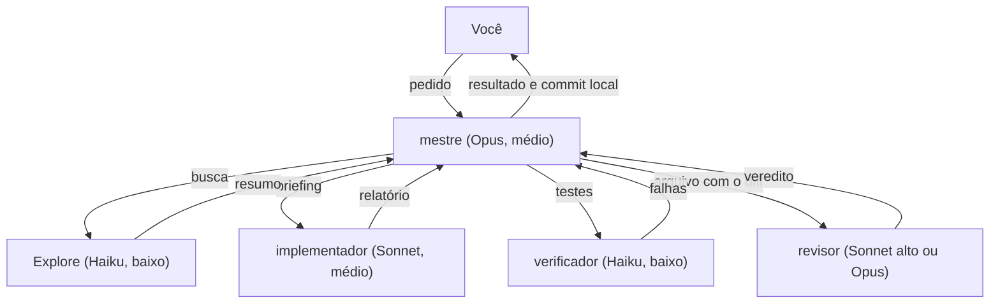

# Equipe de agentes para o Claude Code

Uma sessão principal, o **mestre**, coordena quatro subagentes. Cada um roda no modelo mais barato que dá conta do papel. As regras ficam em camadas, o briefing e o relatório são padronizados, os comandos mais perigosos ficam bloqueados nas configurações e uma guarda limita o terminal dos subagentes: o Explore e o verificador só rodam o que precisam, e o implementador não consegue formatar a pasta inteira.

O objetivo é gastar menos tokens sem abrir mão da qualidade e da segurança do código.

## A equipe

| Agente | Modelo | Esforço | Papel |
|---|---|---|---|
| mestre (a sessão que você abre) | Opus | médio | entende o pedido, planeja, delega, integra, faz o commit e fala com você |
| Explore (explorador) | Haiku | baixo | localiza e resume código; no terminal, só lê o histórico do git; consulta o mapa do código, se instalado |
| implementador | Sonnet | médio | escreve o código dentro do escopo do briefing |
| verificador | Haiku | baixo | roda os comandos de teste, lint, tipos e build listados no projeto e resume as falhas |
| revisor | Sonnet (Opus em área sensível) | alto | revisa o diff com contexto limpo, só leitura, sem terminal |

Você abre **uma sessão só**. O mestre cria os subagentes quando precisa.

O explorador se chama `Explore` de propósito. O Claude Code já traz um subagente com esse nome, que roda no modelo da sessão principal, ou seja, em Opus. Um subagente seu com o mesmo nome substitui o embutido, e assim toda busca passa a rodar em Haiku, inclusive as que o mestre faz por hábito.



## O que vem no repositório

| Caminho | O que é | Vai para |
|---|---|---|
| `rules/equipe-agentes.md` | regras de trabalho: princípios, orquestração, briefing, relatório, segurança | `~/.claude/rules/` |
| `agents/*.md` | os 4 subagentes, com modelo, esforço e ferramentas de cada um | `~/.claude/agents/` |
| `hooks/guarda-comandos.ps1` | guarda de terminal do Explore, do verificador e do implementador | `~/.claude/hooks/` |
| `settings/global.json` | bloqueios que valem em todo projeto | mesclar em `~/.claude/settings.json` |
| `settings/retiradas.json` | regras que versões anteriores acrescentavam e o instalador agora remove | usado pelo instalador |
| `projeto/mcp.supabase-leitura.json` | conexão do Supabase só de leitura, para consultas sem pedir aprovação | `.mcp.json` do projeto |
| `projeto/CLAUDE.md` | modelo do arquivo de cada projeto | raiz do projeto |
| `projeto/nota-de-area.md` | modelo de nota por pasta | `CLAUDE.md` dentro da pasta |
| `projeto/mcp.dart.json` | registro do servidor MCP oficial do Dart | registrado pelo instalador quando o Dart 3.13+ está instalado, ou copiado como `.mcp.json` num projeto |
| `projeto/mcp.codebase-memory.json` | registro do servidor do mapa do código (codebase-memory) | registrado pelo instalador (sempre, a menos que use `-SemMapa`), ou copiado como `.mcp.json` num projeto |
| `ferramentas/registrar-mcp.mjs`, `ferramentas/ler-mcp.mjs` | scripts em Node que o instalador usa para registrar e ler servidores no `.claude.json` | usado pelo instalador |
| `projeto/verificador-comandos.txt` | modelo da lista de comandos que o verificador pode rodar | `.claude/` do projeto |
| `settings/projeto.exemplo.json` | exemplo de bloqueios mais rígidos para um projeto | `.claude/settings.json` do projeto |
| `exemplos/flutter-supabase/` | exemplo preenchido de `CLAUDE.md` e da lista do verificador | referência |
| `baixar-e-instalar.ps1` | baixa ou atualiza o repositório e roda o instalador (a linha do `irm ... \| iex`) | executar |
| `instalar.ps1` | instalador para Windows | executar |
| `testes/` | casos da guarda, teste do instalador e conferência das ferramentas do Dart, que rodam no Windows PowerShell 5.1 e no PowerShell 7 | executar |
| `.github/workflows/testes.yml` | roda os testes no Windows a cada mudança no GitHub | automático |
| `docs/como-funciona.md` | explicação detalhada | leitura |
| `docs/modelos.md` | preços e benchmarks oficiais dos modelos 5.5 e o motivo de cada escolha | leitura |

No Windows, `~/.claude` é a pasta `%USERPROFILE%\.claude`.

## As quatro camadas

| Onde | O quê | Quem lê |
|---|---|---|
| Global (`~/.claude/rules/` e `~/.claude/agents/`) | como trabalhar | todas as sessões, em todos os projetos |
| Projeto (`CLAUDE.md` na raiz) | o que é este projeto: stack, comandos, regras próprias | sessões abertas naquele projeto |
| Configurações (`settings.json`) | o que é proibido | o próprio Claude Code, antes de executar |
| Memória do projeto | onde paramos | só a sessão principal |

Regra prática: instrução que precisa chegar aos subagentes vai nos arquivos de regras, nunca só na memória. Os subagentes não recebem a memória da sessão principal.

## Requisitos

- Claude Code em versão recente: aba Code do app para Windows ou macOS, terminal ou extensão.
- Acesso aos modelos Opus, Sonnet e Haiku.
- Para o instalador: Windows com PowerShell.

## Instalação

### Opção 1: tudo automático (Windows)

Abra o PowerShell (não precisa ser administrador) e cole:

```powershell
irm https://raw.githubusercontent.com/renangr87/claude-equipe-agentes/main/baixar-e-instalar.ps1 | iex
```

Se o app do Claude estiver aberto, o instalador pede para fechar: aperte Enter e ele fecha. Ao terminar, abra o app e comece uma conversa nova. Para atualizar depois, rode a mesma linha: ela faz `git pull` e reinstala só o que mudou.

O que acontece, em ordem:

1. Baixa ou atualiza este repositório em `%USERPROFILE%\claude-equipe-agentes` (instala o Git pelo winget se faltar).
2. Copia os 4 subagentes para `%USERPROFILE%\.claude\agents`, trocando o marcador `__PASTA_CLAUDE__` pelo caminho real da pasta, a guarda de terminal para `hooks` e a regra global para `rules`.
3. Acrescenta os bloqueios ao `%USERPROFILE%\.claude\settings.json`. Só remove regras antigas da própria equipe, listadas em `settings/retiradas.json`; o que você escreveu fica.
4. **Mapa do código:** se o programa faltar, instala pelo instalador oficial, só o binário (`--skip-config`), e registra. Veja [Mapa do código](#mapa-do-código-obrigatório-em-projeto-médio-ou-grande).
5. **Servidor do Dart:** se achar o Dart 3.13 ou mais novo, confere o servidor e registra. Sem Dart, pula. Veja [Servidor do Dart](#servidor-do-dart-opcional).
6. **Apoio Local:** baixa ou atualiza o [apoio-local-ollama](https://github.com/renangr87/apoio-local-ollama) em `%USERPROFILE%\apoio-local-ollama`, cria o ambiente Python dele, liga o Ollama (instala se faltar), baixa o modelo se o Ollama não tiver nenhum e registra. Veja [Apoio local](#apoio-local).

O que faltar no caminho (Node.js, Python 3.12, Git, Ollama) é instalado pelo winget. Um passo que falha não trava os outros: o instalador escreve `ATENCAO` ou `nao registrado` com o motivo e segue.

Ele não apaga arquivos. Antes de alterar um arquivo que já existe, grava uma cópia ao lado com o sufixo `.bak-<data>-<hora>`.

Se você já tem o repositório na máquina, o mesmo resultado sai de:

```powershell
powershell -ExecutionPolicy Bypass -File .\instalar.ps1
```

Opções:

| Opção | O que faz |
|---|---|
| `-SemBloqueios` | não mexe no `settings.json` |
| `-SemMapa`, `-SemDart`, `-SemApoio` | deixa de fora o mapa, o servidor do Dart ou o Apoio Local |
| `-ApoioLocal <servidor.py>` | usa uma cópia do Apoio Local que você já tem, sem baixar |
| `-PastaApoio <pasta>` | onde guardar o Apoio Local baixado |
| `-ModeloApoio <nome>` | modelo fixado no Apoio Local (padrão `gemma4:12b`) |
| `-SemInstalar` | não instala nem baixa nada: só registra o que já existe |

### Opção 2: manual (qualquer sistema)

1. Copie `agents/*.md` para `~/.claude/agents/`. Em `Explore.md`, `verificador.md` e `implementador.md`, troque `__PASTA_CLAUDE__` pelo caminho absoluto da pasta, com barras `/` (no Windows, algo como `C:/Users/voce/.claude`).
2. Copie `hooks/guarda-comandos.ps1` para `~/.claude/hooks/`.
3. Copie `rules/equipe-agentes.md` para `~/.claude/rules/`.
4. Abra `~/.claude/settings.json` (crie se não existir) e acrescente as entradas de `settings/global.json` às listas `permissions.deny` e `permissions.ask`. Se o arquivo não existir, basta copiar `settings/global.json` com o nome `settings.json`.

No macOS e no Linux:

```bash
mkdir -p ~/.claude/agents ~/.claude/rules ~/.claude/hooks
for f in agents/*.md; do
  sed -e "s#__PASTA_CLAUDE__#$HOME/.claude#g" -e 's#"powershell.exe"#"pwsh"#' "$f" > ~/.claude/agents/$(basename "$f")
done
cp hooks/guarda-comandos.ps1 ~/.claude/hooks/
cp rules/equipe-agentes.md ~/.claude/rules/
```

Fora do Windows, a guarda precisa do PowerShell 7 (`pwsh`) instalado. Sem ele, o hook não roda e o terminal desses três agentes fica sem a trava.

### Conferir a instalação

Abra uma sessão nova e faça três testes:

1. Pergunte: **"Quais subagentes você tem disponíveis?"** Devem aparecer implementador, verificador e revisor. O Explore aparece de qualquer forma, porque já existe no Claude Code; o seu o substitui.
2. Pergunte: **"Qual é a regra de commit da equipe?"** A resposta deve citar commit local pelo mestre, com os caminhos dos arquivos, e push só com o seu pedido.
3. Em um repositório git qualquer, peça: **"Rode `git clean -n`."** O comando deve ser recusado pelo bloqueio. O `-n` só simula, então o teste é seguro mesmo que o bloqueio não esteja ativo.
4. No mesmo repositório, peça: **"Use o Explore para rodar `git log -3 --oneline` e depois `git log -1 | sort`."** O primeiro deve funcionar e o segundo deve voltar com a mensagem "Bloqueado pela guarda (explore)". Se o segundo passar, a guarda não está rodando: confira o caminho em `~/.claude/agents/Explore.md`. Um caminho errado desliga a guarda sem aviso.
5. Peça: **"Use o verificador para rodar `git status`."** Deve voltar bloqueado pela guarda (verificador), porque `git status` não está na lista do projeto.
6. Peça: **"Use o implementador para rodar `dart format pasta-que-nao-existe/`."** Deve voltar bloqueado pela guarda (implementador), porque o formatador recebeu uma pasta. O teste é seguro mesmo sem a guarda: a pasta não existe.

## Uso

1. Abra uma sessão na pasta do projeto, com **Opus**, esforço **médio** e o modo de permissão **Auto** (no seletor de modo do app). No modo Manual o Claude Code pergunta antes de quase todo comando e edição, e a sessão trava se você sair. No Auto, um segundo modelo revisa cada ação no seu lugar e só pede a você o que está na lista de confirmação da equipe. O app lembra o modo por pasta.
2. Peça o trabalho normalmente. Não precisa citar os agentes: o mestre decide quando delegar.
3. Na primeira vez em um projeto sem `CLAUDE.md`, o mestre manda o Explore levantar a stack e os comandos, mostra a proposta e grava o arquivo depois do seu OK.

Quando mudar o ajuste da sessão:

- **Esforço alto**: só em planejamento difícil, como decisão de arquitetura ou bug que resistiu a duas tentativas. Depois volte para médio.
- **Sonnet no lugar do Opus**: se o limite de uso estiver apertando. Nos testes oficiais o Sonnet 5.5 quase empata com o Opus 5.5 pela metade do preço; a perda fica no julgamento de casos difíceis. O resto da equipe funciona igual.
- **Fable**: não compensa nesta equipe. Custa 2,5 vezes o Opus 5.5 e fica abaixo dele nos testes oficiais. Os números estão em [`docs/modelos.md`](docs/modelos.md).

## Configurar um projeto

1. Copie `projeto/CLAUDE.md` para a raiz do projeto e preencha. Deixe só o que é daquele projeto: stack, comandos, pastas, qual é o banco de produção, o que não entra em commit. Veja o exemplo em `exemplos/flutter-supabase/CLAUDE.md`.
2. Copie `projeto/verificador-comandos.txt` para `.claude/verificador-comandos.txt` no projeto e liste os comandos de teste, lint, tipos e build, um por linha. Sem essa lista, a guarda bloqueia todo comando do verificador. Faça o commit da lista: a guarda recusa a lista enquanto ela tiver mudança fora de commit, então nenhum agente libera comandos para si mesmo sem que a mudança apareça no git. Quando o mestre cria ou muda a lista pelas ferramentas de arquivo, o Claude Code também pede a sua aprovação, porque `.claude/` é pasta protegida; isso não vale para um script que grave o arquivo por conta própria.
3. Nada a fazer para o diff do revisor: na primeira revisão, o mestre cria a pasta `.revisao/` com um `.gitignore` interno contendo `*`, e ela nunca entra em commit.
4. Se o projeto precisa de bloqueios mais rígidos, crie `.claude/settings.json` na raiz dele a partir de `settings/projeto.exemplo.json`. As listas do projeto se somam às globais.
5. Para as partes do código que exigem conhecimento acumulado, crie uma **nota de área**: copie `projeto/nota-de-area.md` como `CLAUDE.md` dentro da pasta. Ela é carregada quando o mestre ou o implementador abrem arquivos daquela pasta. O Explore, o verificador e o revisor não carregam arquivos `CLAUDE.md`, então o mestre aponta a nota no briefing quando ela importa. É o que substitui o "desenvolvedor que já conhece o assunto".

## Bloqueios: o que fazem e o que não fazem

| Tipo | Comandos | Efeito |
|---|---|---|
| Proibido (`deny`) | `git reset --hard`, `git push --force` e `-f`, `git clean`, `git add -A`, `git add --all`, `git add .`, `git commit -a` | o Claude Code recusa |
| Proibido (`deny`) | leitura, edição e criação de `.env` e `.env.*` em qualquer pasta do computador, inclusive `.env.example` | o Claude Code recusa |
| Pede confirmação (`ask`) | descarte de trabalho: `git restore`, `git checkout -- arquivo`, `git checkout .`, `git checkout -f`, `git stash drop`, `clear` e `pop`, `git reset --merge` e `--keep`, `git switch -f` | aparece um pedido de aprovação para você |
| Pede confirmação (`ask`) | ferramentas do servidor do Dart que chamam métodos arbitrários no app rodando (`vm_service`) ou mudam as pastas que o servidor alcança (`roots`). Hot reload e restart ficam livres; as que mudam arquivos ficam desligadas no próprio servidor | aparece um pedido de aprovação para você |
| Pede confirmação (`ask`) | editar ou criar `analysis_options.yaml`, em qualquer pasta | aparece um pedido de aprovação para você. Evita que o agente afrouxe o analisador para o aviso sumir em vez de corrigir o código. Um comando de terminal que mude o arquivo não passa por essa regra |
| Pede confirmação (`ask`) | ferramentas de escrita de conectores, como as do Supabase: `execute_sql` da conexão que escreve, `apply_migration`, `deploy_edge_function`, segredos, operações de branch e de projeto, envio de arquivo (`upload_file`) | aparece um pedido de aprovação para você |
| Liberado (`allow`) | o Apoio Local (`apoio-local`), modelo do seu computador que só lê as pastas permitidas | roda sem pedir nada |
| Liberado (`allow`) | a conexão do Supabase só de leitura, `supabase-leitura` (veja [Consultas ao banco sem pedir aprovação](#consultas-ao-banco-sem-pedir-aprovação)) | roda sem pedir nada; o próprio Supabase só deixa ler |

**Por que a lista é curta.** Toda regra de confirmação pede aprovação até no modo Auto, e cada pedido trava a sessão até você responder. Por isso a lista fica só com o que é raro e sem volta. `git push` (o push forçado continua proibido), `rm -r` e hot reload saíram: no modo Auto, quem avalia essas ações é o classificador do Claude Code, que barra o que foge do pedido. Instalações anteriores deixaram essas regras no seu `settings.json`; o instalador remove as que estão em `settings/retiradas.json`, só se estiverem escritas exatamente como a equipe escreveu.

Cada regra de comando existe duas vezes, uma para Bash e outra para PowerShell, porque no Windows o agente pode usar qualquer um dos dois.

Limites que você precisa conhecer:

- **O bloqueio compara o texto do comando.** Ele pega a forma usual, não todas. `git push` é barrado, `git -C . push` não é. A documentação do Claude Code diz que essas regras não são uma fronteira de segurança.
- **O bloqueio de `.env` vale para as ferramentas de arquivo e para comandos que o Claude Code reconhece, como `cat`, `head`, `tail` e `sed`.** Uma regra `Read` também barra editar e criar o arquivo, então não há regras `Edit` separadas. Ficam de fora `grep -r` numa pasta, scripts Python ou Node que abrem o arquivo por conta própria e, segundo o que a documentação lista, provavelmente o `Get-Content` do PowerShell.
- **O `.env.example` também fica bloqueado.** A exceção com `!` só vale para regras relativas à pasta da sessão, e a regra `//**/.env.*` precisa ser absoluta para alcançar worktrees e projetos vizinhos. Se você precisa que o agente leia o `.env.example`, troque `Read(//**/.env.*)` pelos nomes que você usa, por exemplo `Read(//**/.env.web.json)`.
- **Instalações anteriores deixaram `Read(.env)`, `Read(.env.*)` e `Read(!.env.example)` no `settings.json`.** O instalador só acrescenta regras e não remove essas. Elas não atrapalham, porque as novas cobrem mais, mas você pode apagá-las.
- **Escrita em banco de produção não se bloqueia por lista de comandos.** Nenhum padrão de texto distingue produção de teste. A proteção de verdade é o agente não ter a credencial de escrita: use chave só de leitura no ambiente dele, ou teste em banco local ou em um branch.
- **Quando uma regra precisa valer sem falha**, o passo seguinte é um [hook PreToolUse](https://code.claude.com/docs/en/hooks), que inspeciona o comando inteiro antes de rodar. A guarda dos subagentes é um hook desse tipo (veja abaixo). O [sandbox](https://code.claude.com/docs/en/sandboxing) não roda no Windows nativo.

## A guarda de terminal

`hooks/guarda-comandos.ps1` roda antes de cada comando de terminal do Explore, do verificador e do implementador, no Bash e no PowerShell. Ela é declarada no próprio arquivo de cada agente, então só vale para eles: o mestre e o revisor não passam por ela. O agente chama o script por dentro de um `try/catch` que bloqueia se o script não rodar (arquivo ausente, política de execução da empresa, erro de sintaxe).

| Agente | O que passa |
|---|---|
| Explore | `git log`, `git blame`, `git show`, `git diff`, `git status` e `git ls-files`, sem `--output`, `--ext-diff`, `--no-index` nem `--contents` |
| verificador | as linhas de `.claude/verificador-comandos.txt` do projeto, exatas ou com argumentos a mais, desde que a lista esteja em commit. Num worktree, vale a lista do próprio worktree, se ela estiver no git |
| implementador | tudo, menos formatador sem arquivos nomeados um a um |

**Implementador.** Formatadores conhecidos (`dart format`, `flutter format`, `dart fix --apply`, `prettier --write`, `eslint --fix`, `black`, `ruff format`, `gofmt -w`, `go fmt`, `cargo fmt`, `dotnet format` e outros) só passam quando cada argumento é um arquivo. Pasta, `.`, curinga, variável, `$(...)` ou nenhum argumento são bloqueados em qualquer parte do comando: em comandos compostos (`cd app && dart format .`), em `xargs`, `find -exec`, `cmd /c`, `bash -c "..."`, `ForEach-Object`, `Start-Process` e `Invoke-Expression`. Redirecionamento (`2>&1`, `> saida.txt`) e nome de arquivo entre aspas com espaço funcionam. O modo só de conferir (`--check`, `--output=none`, `--dry-run`) passa, a não ser que venha junto com a opção de gravar. O texto de `git commit -m`, `grep` e `echo` não é examinado. Scripts como `npm run format` e `make format` são bloqueados, porque escondem o comando real. A lista fica em `$formatadores` no script.

O implementador também tira uma foto do `git status` no começo e no fim da tarefa e relata os arquivos que mudaram. O mestre compara essa lista com o escopo antes do commit. Isso cobre o que a guarda não pega, como um script próprio em Python que reformata arquivos.

**Explore e verificador.** Para os dois, a guarda recusa:
- mais de um comando por vez;
- pipe, redirecionamento, `;`, `&&`, `$`, crase e parênteses fora do texto da lista;
- qualquer comando que cite `.env`, mesmo escondido com aspas ou caractere de escape (`.e""nv`, ``.e`nv``). Um build que lê `.env.web.json`, por exemplo, fica com o mestre.

Limites:
- **Um comando liberado pode fazer o que ele mesmo faz.** Se um teste escreve no banco, a guarda deixa passar. Liste só comandos que não alteram nada fora da pasta de build.
- **O hook depende do `powershell.exe`.** Se ele não for encontrado ou se a guarda passar de 30 segundos, o Claude Code deixa o comando seguir. Os outros casos de falha (script ausente, caminho errado, política de execução) bloqueiam. Os testes 4, 5 e 6 da instalação confirmam que a guarda está ativa.
- **A guarda do implementador pega formatadores conhecidos, não toda forma de reformatar.** Um script próprio que reescreve arquivos passa. Quem cobre isso é a comparação de `git status` antes do commit.
- **A lista do verificador depende do git.** Se a pasta `.claude/` estiver no `.gitignore` do projeto, a checagem de commit não enxerga mudanças.
- **Testes.** `testes/casos-guarda.txt` tem 114 casos e `testes/testar-guarda.ps1` roda todos do mesmo jeito que o hook, mais 5 cenários (entrada vazia, JSON inválido, script ausente, lista fora de commit, lista ausente). `testes/testar-instalador.ps1` faz 98 verificações em pastas temporárias, sem instalar nem baixar nada, com um `dart` falso para o servidor do Dart e um `python` falso (com `.venv` e `pip` simulados) para o Apoio Local. `testes/conferir-dart.ps1` confere os nomes das ferramentas do servidor do Dart. A cada mudança no GitHub, os três rodam no Windows com o PowerShell 5.1 e com o PowerShell 7, e o do Dart roda também com o servidor de verdade, nas versões 3.11.3, 3.12.0, 3.13.0 e na estável. Para rodar na sua máquina: `powershell -ExecutionPolicy Bypass -File .\testes\testar-guarda.ps1`. O app do Windows em si não é testado: os testes 4, 5 e 6 da instalação cobrem essa parte.

## Ferramentas de conectores

O implementador não usa ferramentas de conectores (MCP): o arquivo dele tem `disallowedTools: Agent, mcp__*`. Assim ele não alcança, por exemplo, o banco de produção pelo conector do Supabase. Nos outros agentes e no mestre, as ferramentas de escrita mais comuns pedem confirmação (veja os bloqueios). Se você quiser que o implementador use um conector, troque `mcp__*` pelo nome do servidor que ele não deve usar, por exemplo `mcp__claude_ai_Supabase`.

### Consultas ao banco sem pedir aprovação

A ferramenta `execute_sql` do Supabase é a mesma para ler e para escrever, então na conexão normal ela pede aprovação até para um `select`. Para as consultas do dia a dia, registre no projeto uma segunda conexão, só de leitura:

1. Copie `projeto/mcp.supabase-leitura.json` para a raiz do projeto com o nome `.mcp.json` (ou junte a entrada ao `.mcp.json` que já existir) e troque `TROQUE_PELO_ID_DO_PROJETO` pelo ID do projeto no Supabase (o código que aparece na URL do painel).
2. Abra uma sessão, aceite o servidor do projeto quando o Claude Code perguntar, e autentique o `supabase-leitura` no gerenciador de servidores MCP (`/mcp`). Não precisa de token.

Nessa conexão (`read_only=true`), o Supabase roda toda consulta com um usuário do Postgres que só lê: um `insert` ou `drop` falha no próprio banco. Por isso ela fica liberada (`allow`) na lista da equipe, e a regra manda o mestre usá-la para consultas. A conexão normal continua pedindo aprovação para escrever. O nome `supabase-leitura` importa: é ele que está liberado. As regras de confirmação de `execute_sql` citam os nomes comuns da conexão que escreve (`supabase`, `Supabase`, `claude_ai_Supabase`); se a sua tiver outro nome, acrescente `mcp__<nome>__execute_sql` às regras de confirmação do seu `settings.json`.

## Mapa do código (obrigatório em projeto médio ou grande)

**Quando é obrigatório:** em projeto com mais de 50 arquivos de código, em qualquer linguagem (scripts e infraestrutura contam), ou com mais de um módulo, como app e backend. Na primeira tarefa da sessão nesse projeto, o mestre pede ao Explore para conferir o mapa e indexar se faltar. Se o mapa não estiver instalado, o mestre avisa você uma vez e segue trabalhando sem ele: a falta do mapa não trava a tarefa. Projeto pequeno e pasta sem código não precisam.

O [codebase-memory-mcp](https://github.com/DeusData/codebase-memory-mcp) (DeusData, licença MIT) lê o projeto e monta um mapa de funções, classes e de quem chama quem. Com ele, o Explore responde "onde está" e "quem chama" consultando o mapa em vez de abrir arquivo por arquivo, e o revisor vê o que depende do que mudou. O projeto publica cerca de 10 vezes menos tokens nesse tipo de pergunta, medido em 31 repositórios. Tudo fica no seu computador: o mapa é um banco local e o projeto diz que não envia código nem estatísticas. Dart é suportado com qualidade "boa" (75 a 89%), então chamadas indiretas podem escapar; em ponto crítico, o Explore confirma lendo o trecho.

O instalador da equipe faz os passos 1 e 2 sozinho: se o programa faltar, baixa o instalador oficial e roda com `--skip-config`. Os passos abaixo servem para fazer à mão ou para entender o que ele faz. O programa já instalado não é atualizado pelo instalador da equipe; para isso, feche o app do Claude e editores com IA e rode `codebase-memory-mcp update`.

**1. Instale o programa, só o binário.** O instalador oficial dele também acrescenta skill, agentes e hooks próprios ao Claude Code; esses concorreriam com a equipe e poriam texto extra em todo subagente. Por isso use `--skip-config`:

```powershell
Invoke-WebRequest -Uri https://raw.githubusercontent.com/DeusData/codebase-memory-mcp/main/install.ps1 -OutFile install.ps1
notepad install.ps1        # leia antes de rodar
powershell -ExecutionPolicy Bypass -File .\install.ps1 --skip-config
```

O script confere o checksum do binário antes de instalar. O executável não é assinado: o Windows pode mostrar o aviso do SmartScreen, e o Defender pode acusar `Trojan:Script/Wacatac.B!ml`, que o projeto descreve como falso positivo.

**2. Registre na equipe.** Rode o nosso instalador. O mapa é registrado sempre; só fica de fora com `-SemMapa`. Se o programa não for encontrado nem puder ser instalado, o instalador avisa e segue com o resto. Ele acha o `codebase-memory-mcp` no PATH (ou na pasta padrão do instalador oficial) e registra o caminho completo no `%USERPROFILE%\.claude.json`, com backup antes e sem mexer num registro que já exista. Precisa do Node.js, que faz a junção do arquivo (o `.claude.json` costuma ser grande demais para o Windows PowerShell 5.1). Para usar só num projeto, copie `projeto/mcp.codebase-memory.json` para a raiz dele como `.mcp.json`.

**3. Teste.** Num projeto, peça: **"Use o Explore para dizer quem chama <uma função>."** Na primeira vez ele indexa o projeto.

Como o mapa se mantém atualizado: enquanto houver uma sessão aberta no projeto, o programa observa o git em segundo plano e reindexa só o que mudou. Ao abrir uma sessão nova, ele compara pelo git o que mudou nesse meio-tempo. Pasta sem git não é observada. O Explore e o revisor conferem `index_status` antes de confiar no mapa.

O que fica de fora de propósito:
- **Skill, agentes e hooks do projeto:** não instalados (`--skip-config`).
- **Ferramentas de escrita:** o Explore e o revisor só recebem as de consulta. `delete_project`, `manage_adr` e `ingest_traces` pedem confirmação em `global.json`.
- **Mapa salvo no git:** o projeto oferece gravar `.codebase-memory/graph.db.zst` no repositório, mas o arquivo é regravado a cada atualização e incha o histórico. Deixe desligado (é o padrão) e ponha `.codebase-memory/` no `.gitignore` do projeto.

## Servidor do Dart (opcional)

O [servidor MCP oficial do Dart](https://docs.flutter.dev/ai/mcp-server) (`dart mcp-server`, mantido pelo time do Dart, licença BSD-3, ainda experimental) dá ao Claude o analisador do Dart: erros e avisos de verdade, tipo, definição e referências de um símbolo. Para tipos, é mais preciso que o mapa do código, que em Dart faz só a análise de estrutura. Roda no seu computador e não pede chave.

1. Tenha o Dart 3.13 ou mais novo (`dart --version`; no Flutter, ele vem junto e sobe com `flutter upgrade`). Até o 3.12 o servidor usa outros nomes de opção e de ferramenta, e o instalador recusa.
2. Rode o instalador: com o Dart no PATH, ele registra sozinho (para deixar de fora, use `-SemDart`). Ele acha o `dart` no PATH (no Flutter, usa o `dart.exe` do SDK embutido), confere a versão, sobe o servidor e pede a lista de ferramentas. Só registra no `%USERPROFILE%\.claude.json`, com backup, se o servidor subir e publicar exatamente as ferramentas da equipe; se não, avisa e não mexe em nada. Uma entrada `dart` antiga, diferente da do modelo, é trocada. A documentação do Flutter sugere instalar o plugin `dart-flutter`; aqui registramos só o servidor, sem regras e extras.
3. Para não mandar estatísticas de uso ao Google, rode uma vez `dart --disable-analytics` e `flutter --disable-analytics`.

Quem usa: o Explore (`analyze_files`, `lsp`, `pub_dev_search` e leitura de pacotes) e o revisor (`analyze_files`, `lsp`).

O servidor sobe com `--disable all` e um `--enable` para cada ferramenta que a equipe usa. O que não foi habilitado por nome fica desligado, inclusive ferramentas que uma versão futura criar ou renomear: nada novo entra sem passar pela lista de confirmação. As ferramentas ficam em quatro grupos, listados em `testes/dart-ferramentas.txt`:

| Grupo | Ferramentas | Como fica |
|---|---|---|
| leitura | `analyze_files`, `lsp`, `pub_dev_search`, `read_package_uris`, `rip_grep_packages` | ligadas e liberadas; são as do Explore e do revisor |
| livre | `get_runtime_errors`, `widget_inspector`, `hot_reload`, `hot_restart`, `flutter_driver_command`, `dtd` | ligadas e liberadas; consultam ou recarregam o app rodando, coisa do dia a dia |
| confirmar | `vm_service`, `roots` | ligadas; pedem a sua confirmação. `vm_service` chama qualquer método no app rodando e `roots` muda as pastas que o servidor alcança |
| desligada | `pub`, `dart_fix`, `dart_format`, `create_project`, `run_tests`, `launch_app`, `stop_app`, `list_devices`, `list_running_apps`, `get_app_logs`, `get_active_location` | desligadas no servidor. Rodar o app, os testes e o `pub` fica com o terminal, como o próprio time do Dart recomenda |

Os nomes foram conferidos no código do servidor (`ToolNames`, em `lib/src/utils/names.dart` do [dart-lang/ai](https://github.com/dart-lang/ai)). O teste `testes/conferir-dart.ps1` sobe o servidor, pede a lista e falha se ela não for exatamente a habilitada; também avisa de ferramentas novas que ainda não têm grupo. No GitHub ele roda a cada mudança e toda segunda-feira, com o Dart 3.13.0 e o estável, e confirma que o 3.11 e o 3.12 são recusados.

Desde o 3.13, o servidor é o pacote `dart_mcp_server` do pub, que ganha versões fora do ciclo do Flutter. Se um nome habilitado sumir, o servidor não sobe e o Claude Code mostra `dart` como desconectado (CONNECTION_CLOSED): nada fica liberado por engano. Para conferir a sua máquina, rode `powershell -ExecutionPolicy Bypass -File .\testes\conferir-dart.ps1`; ele mostra o que não bate.

## Apoio local

O [Apoio Local](https://github.com/renangr87/apoio-local-ollama) é um servidor MCP que entrega o trabalho braçal a um modelo do Ollama rodando no seu computador: ler e resumir arquivos grandes, extrair campos, classificar arquivos em lote e rascunhar textos. O Claude manda o caminho do arquivo e recebe só a resposta, então gasta menos tokens e o conteúdo não sai da máquina.

O instalador da equipe instala e registra sozinho (só fica de fora com `-SemApoio`):

1. **Cópia:** se já houver um `apoio-local` registrado, usa a cópia dele; senão, usa ou clona `%USERPROFILE%\apoio-local-ollama`. O repositório é privado: na primeira vez, o Git abre o login do GitHub no navegador. Cópia que é clone do git é atualizada com `git pull --ff-only` (com mudança local, fica como está). Para usar outra cópia, passe `-ApoioLocal <servidor.py>`.
2. **Python:** cria o ambiente próprio `.venv` dentro da cópia, com as versões fixadas no `requirements.txt`, sem mexer no Python do sistema. Se faltar Python 3.12, instala pelo winget.
3. **Ollama:** se não responder, liga; se não estiver instalado, instala pelo winget. Se o Ollama não tiver nenhum modelo, baixa o `gemma4:12b` (uns 8 GB, o recomendado para placa de 16 GB). Se o modelo estiver instalado, fixa ele no registro; se houver outros e não ele, o Apoio usa o maior. Outro modelo: `-ModeloApoio <nome>`.
4. **Registro:** grava o servidor `apoio-local` no `%USERPROFILE%\.claude.json`, com backup. Ajustes que já estavam no registro (por exemplo, `APOIO_LOCAL_URL` apontando para o Ollama de casa, feito pelos scripts `remoto\` do Apoio) são mantidos, e nesse caso o instalador não mexe no Ollama local.

Como a equipe usa, sem perder qualidade:

| Quem | Usa para | Não usa para |
|---|---|---|
| mestre | log, PDF, CSV, documentação e saída de comando longa; muitos arquivos para classificar; documentos pessoais (por ele; sem ele, só com a sua permissão) | código que vai mudar, decisões, revisão, segurança, verificação final |
| Explore | arquivo que não é código com mais de ~300 linhas, ou muitos arquivos de uma vez | busca e leitura de código (Grep e Read continuam) |
| implementador, verificador, revisor | não usam | a revisão e a verificação continuam com o Claude |

Se o Apoio não estiver disponível (não instalado, Ollama desligado ou erro), a leitura comum segue normal pelo Claude. Documento pessoal não: o agente deixa esse passo para o fim, termina o resto e pergunta uma vez se pode ler direto ou se você prefere ligar o Ollama.

A resposta do modelo local é tratada como pista: antes de agir ou relatar, o agente confere com Read o trecho que ela aponta, e números, nomes, caminhos e códigos de saída sempre na fonte. É isso que segura a qualidade. Rascunhos do `delegar` vão para um arquivo novo e passam por revisão antes de serem usados.

O que esperar: a economia aparece nas leituras grandes, que hoje enchem o contexto do mestre (Opus). Em leitura pequena e em código não compensa, porque o modelo local leva de dezenas de segundos a minutos. As ferramentas `apoio-local` estão liberadas na lista (`allow`): leem só as pastas que o próprio servidor permite e só gravam arquivo novo na pasta temporária dele.

## Personalizar

- **Modelo e esforço de um subagente**: mude `model` e `effort` no início do arquivo dele em `~/.claude/agents/`.
- **Comandos do verificador**: edite `.claude/verificador-comandos.txt` do projeto.
- **Comandos do Explore**: a lista fica no perfil `explore` de `hooks/guarda-comandos.ps1`.
- **Formatadores barrados no implementador**: a lista `$formatadores` em `hooks/guarda-comandos.ps1`.
- **Quando a revisão é obrigatória**: mude os limites (50 linhas, 3 arquivos) em `rules/equipe-agentes.md` e na descrição de `agents/revisor.md`.
- **Idioma e tom**: seção "Comunicação" de `rules/equipe-agentes.md`.
- **Um subagente diferente só em um projeto**: crie `.claude/agents/<nome>.md` no projeto. Ele tem prioridade sobre o global de mesmo nome.
- **Um especialista que guarda o assunto**: para uma parte difícil do sistema, crie no projeto um subagente próprio com o campo `memory: project`. Ele mantém anotações entre conversas em `.claude/agent-memory/<nome>/`. Custa mais do que a nota de área, porque as anotações são carregadas a cada chamada, então use só onde o assunto justifica.

Depois de editar os arquivos do repositório, rode o instalador de novo.

## Desinstalar

1. Apague `Explore.md`, `implementador.md`, `verificador.md` e `revisor.md` de `~/.claude/agents/`.
2. Apague `equipe-agentes.md` de `~/.claude/rules/` e `guarda-comandos.ps1` de `~/.claude/hooks/`.
3. Em `~/.claude/settings.json`, remova as entradas listadas em `settings/global.json`, ou restaure a cópia `.bak` criada pelo instalador.
4. Remova as entradas `codebase-memory`, `dart` e `apoio-local` de `mcpServers` em `%USERPROFILE%\.claude.json`, com o app fechado, ou restaure a cópia `.bak` dele. O programa sai com `codebase-memory-mcp uninstall`.

## Limitações conhecidas

- **Regra escrita é orientação.** O agente pode esquecer ou interpretar errado. O que trava de fato são as ferramentas de cada subagente e os bloqueios do `settings.json`, com os limites descritos acima. O revisor não tem terminal nem ferramenta de edição. O Explore e o verificador têm terminal, limitado pela guarda, e nenhum dos dois tem ferramenta de edição. O implementador tem tudo, menos formatador em pasta.
- **Multiagente não reduz tokens por si só.** Cada subagente começa do zero e relê o que precisa. A economia vem do trabalho volumoso em modelo barato, do contexto enxuto do mestre e de não delegar tarefa pequena.
- **Tudo passa pelo mestre.** Em sessões muito longas o contexto dele enche. Feche a rodada, deixe o estado anotado e abra uma sessão nova.
- **Ainda não foi medido em uso real.** Os limites de revisão e a divisão de modelos são um ponto de partida. Compare custo e qualidade em uma tarefa antes de adotar em tudo.
- **O que o instalador baixa não passa pelos testes.** Os testes rodam com `-SemInstalar` e programas falsos (`dart`, `python`, mapa): winget, o instalador oficial do mapa, o clone do Apoio Local e o download do modelo só rodam de verdade na sua máquina. Se um deles falhar, o instalador escreve o motivo e segue com o resto.
- **O que cada subagente carrega.** Pela documentação, o subagente recebe o próprio prompt, não o do Claude Code. O implementador carrega também a regra global (uns 2 mil tokens, 800 deles de orquestração, que só serve ao mestre) e o `CLAUDE.md` do projeto. O Explore, o verificador e o revisor usam `omitClaudeMd: true` e, segundo a documentação, carregam só arquivos de política gerenciada: tudo o que precisam vem no briefing. Para conferir, peça ao Explore qual é a regra de commit da equipe: ele não deve saber.
- **`isolation: worktree` não é o padrão para tarefas paralelas.** O worktree nasce do branch padrão, não do trabalho em andamento, e o resultado precisa ser trazido de volta depois.

## Licença

[MIT](LICENSE). Use, copie e adapte à vontade, mantendo o aviso de licença.

## Créditos

Os quatro princípios de trabalho são uma adaptação de [karpathy-guidelines](https://github.com/multica-ai/andrej-karpathy-skills), da multica-ai (licença MIT), que por sua vez se baseia em observações de Andrej Karpathy sobre erros comuns de modelos ao programar.

Referências da documentação do Claude Code: [subagentes](https://code.claude.com/docs/en/sub-agents), [CLAUDE.md e regras](https://code.claude.com/docs/en/memory), [permissões](https://code.claude.com/docs/en/permissions), [hooks](https://code.claude.com/docs/en/hooks), [modelos e esforço](https://code.claude.com/docs/en/model-config).
